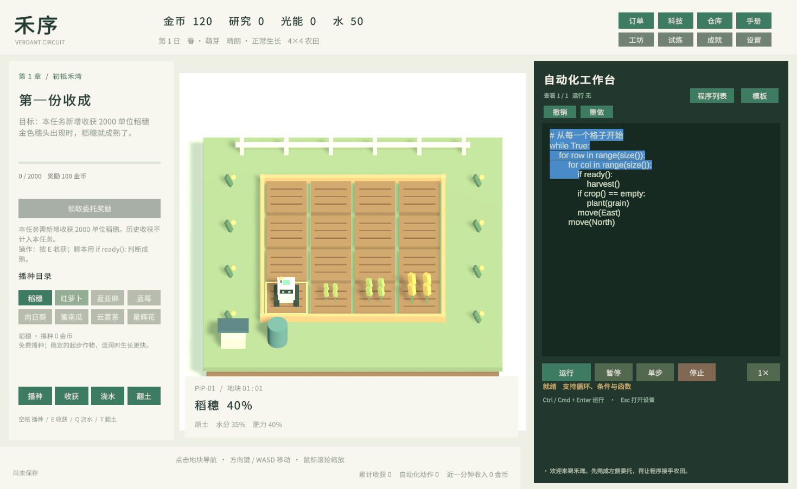

<div align="center">

# 禾序 · Verdant Circuit

**把重复劳动写成程序，让农场自己运转。**

A programming farming game built with Unity. Grow crops, observe the soil, and turn a small robot into an automated farm.

[下载 v0.10.1](https://github.com/13536309143/verdant-circuit/releases/tag/v0.10.1) · [快速开始](docs/GETTING_STARTED.md) · [内部测试](docs/TESTING.md) · [扩展设计](docs/ROADMAP.md)


</div>



禾序是一款单人编程农场游戏。玩家先亲手播种和收获，再使用受 Python 启发的农场语言，编写循环、条件与函数，让巡田机器人照看作物。水分、肥力、邻接关系与光能让“遍历一遍农田”逐渐变成需要设计的生产系统。

当前版本是 **v0.10.1 公开测试发行版**。它可以在 macOS 独立运行，也可以通过本仓库继续开发。多无人机、不同尺寸机体与浮空岛仍处于设计和独立规则原型阶段，尚未接入可玩场景。

## 游戏内容

| 系统 | 已实现内容 |
|---|---|
| 农场 | 4×4 → 6×6 → 8×8 扩田，四季与降雨，水分与肥力 |
| 作物 | 稻穗、红萝卜、蓝亚麻、蓝莓、向日葵、蜜南瓜、云雾茶、星辉花 |
| 农艺 | 翻土、灌溉、施肥、再生收获、间作增产、成熟邻接和光能供给 |
| 进度 | 6 章、30 份主线委托、18 项研究、12 项成就 |
| 挑战与经济 | 6 项独立限时试炼、5 种加工配方、3 个更新的供给订单槽 |
| 编程 | 变量、表达式、循环、条件、无参数函数、传感器、执行行与变量观察 |
| 编辑器 | 可见光标和选区、每份程序 100 步会话撤销/重做、可增删的程序列表 |
| 执行 | 查看其他程序不打断当前程序；运行新程序会替换当前执行，始终只有一个 VM |
| 保存 | 自动保存、手动保存、滚动备份、损坏恢复和新开局前备份 |

### 从数量目标到自动化方案

作物委托统计**接取任务后的新增收获**，达量即可领取奖励，没有固定等待 600 秒的条件。科技与更有效率的代码可以缩短生产周期。

| 作物 | 任务数量 | 作物 | 任务数量 |
|---|---:|---|---:|
| 稻穗 | 2000 | 向日葵 | 1300 |
| 红萝卜 | 1000 | 蜜南瓜 | 1200 |
| 蓝亚麻 | 1400 | 云雾茶 | 1250 |
| 蓝莓 | 2400 | 星辉花 | 500 |

在 6×6 空田、解锁所需作物与灌溉、无马达/增产加成、启动资源充足的基准模拟中，对应范例完成各目标约需 11.5～12.6 分钟。这是数值校准条件；真人操作、农田尺寸和科技组合会改变实际用时。[查看基准记录](docs/reports/作物数量-基准验证.json)。

## 下载与安装

1. 打开 [v0.10.1 Releases](https://github.com/13536309143/verdant-circuit/releases/tag/v0.10.1)。
2. 下载 `HeXu-macOS-0.10.1.zip`，解压后打开 `HeXu-0.10.1.app`。包含 Intel x86_64 和 Apple Silicon arm64 两种架构，无需安装 Unity。
3. 已有旧版时，先在旧版选择“设置 → 保存并退出”，再启动新版。
4. 首次体验可从“开始农耕”进入；需要全新进度时选择“设置 → 新建农场”。

此包为本机构建，尚未进行发行签名和 Apple 公证；系统是否允许启动取决于本机安全策略。遇到启动拦截请记录系统提示，勿将其误判为游戏存档损坏。本仓库尚未提供 Windows、Linux、WebGL 或 Steam 构建。

## 怎么玩

1. **认识机器人**：方向键或 WASD 移动；越过农田边界会环绕，也可以点击地块导航。
2. **认识作物**：选择稻穗，空格播种，成熟后按 E 收获。萝卜需要先翻土，蓝莓需要湿润土壤。
3. **写出循环**：将下面的程序粘贴到右侧工作台，点击“运行”或按 Cmd/Ctrl+Enter。
4. **观察和改进**：使用暂停、单步和变量显示排查程序；通过科技树解锁农艺，再按任务目标调整方案。
5. **领取奖励**：目标满足后主动点击“领取委托奖励”，每五份委托进入下一章。

```python
while True:
    for row in range(size()):
        for col in range(size()):
            if ready():
                harvest()
            if crop() == empty:
                plant(grain)
            move(East)
        move(North)
```

| 操作 | 快捷键 / 方法 |
|---|---|
| 移动 / 地块导航 | 方向键、WASD / 点击农田 |
| 播种 / 收获 | 空格 / E |
| 浇水 / 翻土 / 施肥 | Q / T / F，需要满足相应农艺条件 |
| 运行 | Cmd/Ctrl+Enter 或“运行” |
| 撤销 | Cmd/Ctrl+Z |
| 重做 | Cmd/Ctrl+Shift+Z 或 Ctrl+Y，也可点按钮 |
| 管理程序 | “程序列表”，可新增、查看、删除，至少保留一份 |
| 缩放农田 | 鼠标滚轮 |
| 设置 / 关闭弹窗 | Esc |

编辑代码时，农耕快捷键让位给文本输入。“暂停”只暂停程序，作物仍可生长；设置、研究等弹窗会暂停模拟，程序列表除外。运行中的程序必须先停止再删除。撤销历史保存在当前会话中，程序内容会写入存档。

### 农场语言

这是一种有限的游戏内语言，**不是完整 Python**。支持四空格缩进、`if/elif/else`、`while`、`for ... in range(...)`、`repeat`、变量、布尔表达式、无参数 `def`、`break/continue/return` 与注释。

- 动作：`move()`、`plant()`、`harvest()`、`till()`、`water()`、`fertilize()`、`wait()`、`print()`。
- 传感器：`ready()`、`crop()`、`moisture()`、`fertility()`、`x()`、`y()`、`size()`、`count()`、`neighbors()`、`energy()`、`money()`。
- 程序不访问电脑文件或网络；包含分帧指令预算、递归深度和总指令上限。
- `count(grain)` 是当前库存；主线的新增收获不会被加工和交付倒扣。
- 灌溉任务范例使用 `moisture() < 0.6`，以兼容保水科技与周期降雨。顶部的水仓余额和地块水分是两个指标。

游戏内“手册”和 [完整测试手册](docs/TESTING.md) 提供更多可复制程序。

## 本地开发与构建部署

### 环境与打开工程

- 优先使用 `ProjectSettings/ProjectVersion.txt` 指定的 **Unity 2022.3.62f3c1**。其他 2022.3 编辑器需自行验证兼容性。
- 构建 macOS 需要安装对应 Editor 的 Mac Build Support 和有效的 Unity 编辑器许可。
- Package Manager 首次打开会下载依赖；编辑器用的 Unity MCP 已固定到发行时解析的提交。**玩发行包无需安装或连接 MCP 服务**。

```bash
git clone https://github.com/13536309143/verdant-circuit.git
cd verdant-circuit
```

在 Unity Hub 中添加仓库根目录，打开 `Assets/VerdantCircuit/Scenes/VerdantCircuit.unity`，点击 Play。不要同时运行独立应用和同配置的 Editor Play，以免共同写入玩家存档。

### 使用 Unity 构建

1. 打开主游戏场景，等待脚本编译完成。
2. 菜单选择 **Tools → 禾序 → 发行 → 构建 macOS 通用版**。
3. 输出默认为 `Builds/HeXu-0.10.1.app`。该入口显式包含主游戏场景并选择 Universal 架构。
4. 也可在 **File → Build Settings** 中选择主游戏场景、目标 macOS、Architecture = Intel 64-bit + Apple Silicon，执行 Build。
5. 分发时使用 `ditto` 压缩，保留应用内启动文件的权限与资源：

```bash
ditto -c -k --sequesterRsrc --keepParent \
  Builds/HeXu-0.10.1.app HeXu-macOS-0.10.1.zip
shasum -a 256 HeXu-macOS-0.10.1.zip
```

### 命令行构建

先关闭此工程的 Unity Editor，再指定本机 Unity 可执行文件的真实位置：

```bash
export VERDANT_UNITY_EDITOR="/你的Unity安装路径/Unity.app/Contents/MacOS/Unity"
bash tools/build-macos.sh
```

脚本先执行规则与主线回归，再构建和打包。日志、应用和校验和放在 `Builds/release/`。首次依赖导入可能较久。它不会自动完成发行签名、公证或上传 GitHub，也不需要把账号密钥放进仓库。

这是本地运行的单机游戏，发布部署是上传 macOS 应用包到 GitHub Releases，不需要部署后端服务。每次发行应从明确的提交构建、记录校验和，并将源码标签与安装包对应起来。

## 验证与测试

v0.10.1 的交付记录包括：

- **50 项游戏规则检查**，覆盖语言、存档、农艺、灌溉、撤销历史、程序列表和数量目标边界。
- **30 份主线回放**与 **6 项试炼范例**通过。
- 程序切换保留 VM、运行新程序替换 VM、运行中删除保护及领奖按钮状态检查。
- 光标、选区和科技树的游戏画面检查。
- **24 项机群/群岛规则原型检查**；这是独立模型，不是已上线的机群玩法。

[验证记录](docs/reports/)用于说明规则可达性；它们不能替代不同设备上的真人交互、长期稳定性与平衡测试。

```bash
# 独立规则原型，无需 Unity
python3 tools/verify_fleet_rules.py
```

在 Unity 中选择 **Tools → 禾序 → 发行 → 运行规则与主线回归**，或按照 [测试手册](docs/TESTING.md) 执行完整人工测试。自动回归使用独立测试存档；正式测试前仍建议备份玩家存档。

## 存档与升级

macOS 默认存档：

```text
~/Library/Application Support/Fieldworks/禾序/verdant-farm.json
```

`.bak` 是上一份滚动备份，新建农场会另外生成带日期的备份。升级不删除既有程序或已领委托；后续新接取的作物任务采用新增收获基线。应用退出后再备份或替换文件，避免自动保存覆盖手工改动。

## 项目结构

```text
Assets/VerdantCircuit/
  Scripts/          农场规则、语言 VM、编辑器 UI、经济与程序管理
  Editor/           场景生成、自动回归与发行构建入口
  Scenes/           主游戏场景
  Fonts/            中文字体与 TMP 字体资源
  Resources/        运行时材质引用
Assets/FarmPrototype/  早期原型，保留用于对照
Packages/              依赖清单与锁定版本
ProjectSettings/       Unity 工程设置
docs/                 玩法、测试、路线图、截图与验证报告
tools/                构建脚本与独立玩法规则原型
```

## 版本与路线图

[v0.10.1 更新日志](CHANGELOG.md)记录本次数量任务、代码编辑器和科技树调整。

后续方向是一个中央程序协调多台不同尺寸的无人机，用占地预约、渡口队列与跨岛风窗解决农业物流问题。规则与接口见 [扩展设计](docs/ROADMAP.md)。其中的拟议接口尚不能在当前 VM 中调用；本版没有 Steam 云存档、平台成就、联网机群或群岛场景。

## 反馈与贡献

欢迎通过 [Issues](https://github.com/13536309143/verdant-circuit/issues)提交复现步骤、改进意见和玩法建议。请附版本、Mac 芯片与系统、运行方式、预期/实际表现，必要时附代码与相关日志。玩家存档、个人路径和凭据请勿直接贴到公开 Issue。

修改规则后请运行回归；修改交互后请补充真实鼠标/键盘检查。构建产物、`Library/`、玩家存档和本机配置不进入 Git。

## 致谢与许可

项目受编程农场这一玩法类型启发，未使用 Steam 原作的源代码或美术。程序、界面与几何造型为本项目实现，环境音乐与操作音效由程序合成。

Noto Sans CJK 和 Liberation Sans 等字体遵循各自附带的 SIL Open Font License；Unity 和相关包按各自许可使用。参见 [第三方说明](THIRD_PARTY_NOTICES.md)。本项目暂未指定统一的开源许可证；公开仓库不改变第三方许可，也不自动授予项目代码的额外使用授权。
