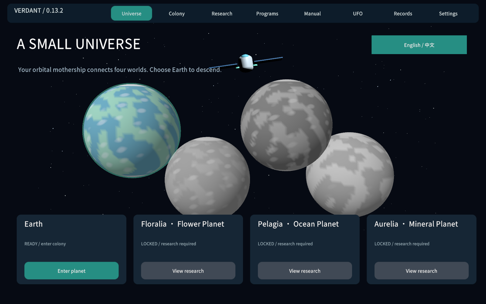

# Verdant Circuit · 禾序

**Start with one plot. Program a living universe.**

**English** · [简体中文](README.zh-CN.md) · [Download v0.13.2](https://github.com/13536309143/verdant-circuit/releases/tag/v0.13.2) · [Full manual](docs/MANUAL.md)

Verdant Circuit is a single-player programming and production game built with Unity. Harvest your first patch of grass, develop an automated farm on a sphere, then connect flower, ocean and mineral colonies through an orbital mothership. Write Python-inspired programs for individual workers, local swarms, planet managers and the universe itself.

| Current release | Platforms | Languages | Development |
|---|---|---|---|
| **0.13.2 · Orbital Mothership** — public preview, Night theme included | macOS Intel / Apple Silicon · Windows x64 | English by default · 简体中文 | Unity **2022.3.62f3c1** |



## Download and play

Download the complete archive for your platform from [v0.13.2 Releases](https://github.com/13536309143/verdant-circuit/releases/tag/v0.13.2).

| Download | What it contains | Start here |
|---|---|---|
| [macOS](https://github.com/13536309143/verdant-circuit/releases/download/v0.13.2/HeXu-macOS-0.13.2.zip) | Universal app for Apple Silicon and Intel | Extract and open `HeXu-0.13.2.app` |
| [Windows x64](https://github.com/13536309143/verdant-circuit/releases/download/v0.13.2/HeXu-Windows-x64-0.13.2.zip) | Executable, data and Mono runtime | Extract the **whole folder**, then run `HeXu.exe` |
| [Unity source](https://github.com/13536309143/verdant-circuit/releases/download/v0.13.2/HeXu-Source-0.13.2.zip) | Project, bilingual documentation and build tools | Open the extracted project in the matching Editor |
| [Program kit](https://github.com/13536309143/verdant-circuit/releases/download/v0.13.2/HeXu-Program-Kit-0.13.2.zip) | 11 complete example files, manuals and validation records | Follow the included English or Chinese README |
| [Test evidence](https://github.com/13536309143/verdant-circuit/releases/download/v0.13.2/HeXu-TestEvidence-0.13.2.zip) | Rules, UI, timing, build and Night-patch reports | Read `README.md` in the archive |

Use [SHA256SUMS-0.13.2.txt](https://github.com/13536309143/verdant-circuit/releases/download/v0.13.2/SHA256SUMS-0.13.2.txt) to verify downloads. Keep earlier releases available through the [release history](https://github.com/13536309143/verdant-circuit/releases).

The Mac app is unsigned, not notarized, and carries the current Unity trial watermark. Windows was cross-built on Mac and still needs native Windows acceptance testing. Neither platform needs a Unity installation to play. Linux, browser and Steam builds are not included.

## Your first harvest

1. Choose **Earth** in the universe view. The shuttle descends from the mothership; only Earth is initially unlocked.
2. Wait for the first grass plot to mature. Its visible growth percentage should reach 100%.
3. Run the initial `harvest()` program. Repeat as grass regrows; collect five hay and purchase **Loops** in Research.
4. Run the loop below for continuous harvesting. Research Planting, sensors, variables and staged field expansion as supplies allow.
5. Create files in **Programs**, bind them to a worker, planet or universe target, then run them. Viewing a different file keeps existing work active.

```python
# Requires Loops. Bind to the Earth drone.
while True:
    harvest()
```

Use the top bar for Universe, Colony, Research, Programs, Manual, UFO, Records and Settings. **F8** switches languages; **Ctrl/Cmd+Enter** runs code; **Ctrl/Cmd+Z** undoes edits. Scroll to zoom the planet, right-drag to orbit, or choose **Focus worker**. The interface uses **Night** styling with distinct planet accents.

[The walkthrough](docs/UNIVERSE-0.13.2.md) explains progression and the 11-file controller example. Examples require actual research and supplies; they do not automatically solve the campaign.

## Four worlds, one supply network

| ID | World | Native worker | Specialization |
|---|---|---|---|
| `0` | Earth | Drone | Original crops, water, compost, fish feed and solar energy |
| `1` | Floralia · Flower Planet | Bee | Six flower varieties and honey |
| `2` | Pelagia · Ocean Planet | Fishing boat | Six fish species, matching shoals and fishmeal |
| `3` | Aurelia · Mineral Planet | Mining drone | Raw deposits, smelting, refining and diamond cutting |
| `-1` | Orbital mothership | UFO docking and warehouse | Persistent resource storage and transport hub |

Earth retains giant pumpkins, cactus sorting, companion planting, hedge mazes and long-tail exploration. Later colonies extend the same progression. **24 multi-product projects**, **31 production recipes** and **13 specialist technology branches** connect the worlds.

- **Spherical farming:** expand from `1×1` to `360×128` through paid discoveries. The maximum is 46,080 one-degree cells between latitude −64° and +64°; the poles remain untouched. Longitude wraps only at the full 360 columns; latitude never wraps. Expansion preserves crops and recenters local coordinates.
- **Native fleets:** each planet separately unlocks worker count and hulls: `1×1`, `2×1`, `2×2`, `3×2`, `3×3`. Production inputs and outputs scale with footprint; routes check occupied cells. Keep lanes available for larger craft.
- **Real freight:** workers remain local. UFOs reserve cargo, consume battery, fly through the mothership and unload only on arrival. Refueling uses solar energy at the current dock. Cancellation returns unused reservations; airborne goods finish the current leg, possibly entering the mothership warehouse.
- **Separate research sectors:** Universe contains planet discoveries and orbital science. Each planet has its own research. Production, automation, ecology and transport use different colors; researched nodes brighten.
- **Visible work:** growing crop shapes, harvest bursts, rotating planets, atmospheric effects, bee wings, drone rotors, boat propellers and mining drills. Crop batches, visibility checks and pooled effects bound the rendering load.

Resource names distinguish `coins` (treasure coins), `gold_ore` (raw ore) and `gold` (bullion). Raw minerals and refined materials have separate production functions and inventories.

## Program the hierarchy

```text
Universe controller
├── Earth manager → drone programs
├── Flower manager → bee swarms
├── Ocean manager → fishing fleets
└── Mineral manager → mining-drone groups
                  ↕ UFO routes through the mothership
```

Each worker or manager runs one interpreter at a time. Swarm members run independent copies of a shared file. Modules, copied inbox messages and returned results coordinate their work. A parent can finish while its child programs continue. Physical production queues may continue after code stops; use the documented cancellation controls when needed.

For example, send a real payload to the mothership after researching Spaceflight and funding UFO construction:

```python
ship = ufo_build()
if ship > 0 and planet_inventory(0, "water") >= 24:
    if ufo_transfer(ship, 0, -1, "water", 24):
        ufo_wait(ship)
        print(mothership_inventory("water"))
```

The language is a **Python-inspired subset**, not CPython. It supports functions, modules, collections and documented numeric/string helpers; it does not provide the Python standard library, operating-system access or keyword arguments. Debugging includes pause/step, breakpoints, variable inspection, undo/redo and external file editing.

## Manual and tested scope

| Resource | Contents |
|---|---|
| [English manual](docs/MANUAL.md) · [中文手册](docs/MANUAL.zh-CN.md) | 19 chapters, 218 function/method entries, parameter and return contracts, all recipes and projects |
| [English walkthrough](docs/UNIVERSE-0.13.2.md) · [中文操作与代码](docs/UNIVERSE-0.13.2.zh-CN.md) | Progression steps and 11 complete hierarchy files |
| [Testing guide](docs/TESTING.md) | Reproducible Editor commands and manual acceptance steps |
| [Campaign / rendering evidence](docs/reports/v0.13.2/README.md) | 452 rule assertions, 64 UI checks, 24-project fresh-start walkthrough and rendering measurements |
| [Night patch evidence](docs/reports/v0.13.2-night/README.md) | 66 UI checks, legacy theme compatibility and both platform build reports |

The fresh reference walkthrough starts with **one plot, zero inventory and zero research**. It completes all 24 main projects in approximately **38h 15m of game time**, using one paid `2×2` worker per planet and the documented scheduling policy. More workers and better parallel planning can shorten that substantially. This is **not a guaranteed minimum playtime or a speedrun**, and excludes human programming time and optional completion goals. The Night patch changes presentation only; its report identifies the separate source revision.

## Saves and upgrades

Save and quit an older running game before opening the new app. v0.13.2 retains v0.13.1 universe progress in `Application.persistentDataPath/Automation/Universe0131`; pre-universe farm files remain separate. Settings shows the actual save path. Legacy theme preferences are ignored in favor of Night.

Saves retain worlds, stock, workers, battery, cargo, physical queues, swarms and file bindings. Interpreter stacks, inboxes and return objects are transient. After loading, inspect existing jobs and restart the appropriate controllers. Back up saves before moving between versions; earlier releases are not guaranteed to read newer save fields.

## Develop and build

```bash
git clone https://github.com/13536309143/verdant-circuit.git
cd verdant-circuit
```

Open the project with **Unity 2022.3.62f3c1**, let packages import, then open `Assets/VerdantCircuit/Scenes/VerdantCircuit.unity` and press Play. Install Mac Build Support and/or **Windows Build Support (Mono)** for that Editor. Windows x64 Mono builds can be produced from Mac.

```bash
# Set this to the Unity executable installed on your machine.
export VERDANT_UNITY_EDITOR="/Applications/Unity/Hub/Editor/2022.3.62f3c1/Unity.app/Contents/MacOS/Unity"
./tools/build-macos.sh
./tools/build-windows.sh
```

Build scripts refresh bilingual tables, run rule checks, and place apps, ZIPs, logs and checksums in `Builds/release`. They do not publish to GitHub. Unity MCP is optional for development and is not required to run the game. See the [testing guide](docs/TESTING.md) for UI checks and the fresh campaign replay.

## Credits and licensing

Implemented independently with original procedural visuals; no source code or art assets from *The Farmer Was Replaced* are included. See [third-party notices](THIRD_PARTY_NOTICES.md) for fonts and Unity components. Public source availability does not grant an open-source license: a project-wide license has not yet been specified.

[Changelog](CHANGELOG.md) · [Releases](https://github.com/13536309143/verdant-circuit/releases) · [Report an issue](https://github.com/13536309143/verdant-circuit/issues)
