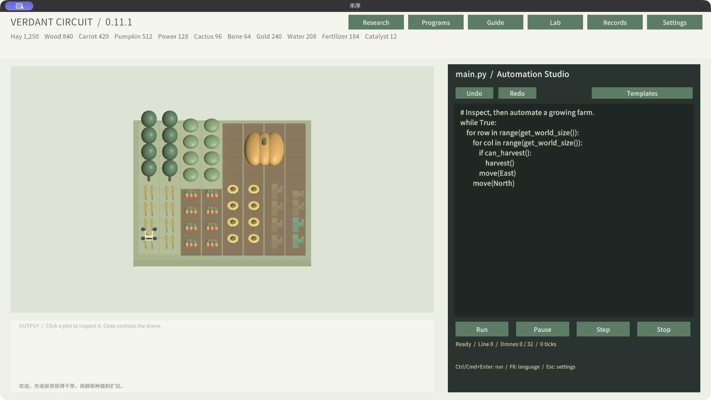

# Verdant Circuit · 禾序

**Program the farm. Discover the algorithm.**

**English** · [简体中文](README.zh-CN.md) · [Download 0.11.1](https://github.com/13536309143/verdant-circuit/releases/tag/v0.11.1) · [Test guide](docs/TESTING.md)

Verdant Circuit is a single-player programming farm, independently implemented in Unity. Write Python-inspired code to grow resources, unlock technology and solve different agricultural algorithms.

**0.11.1 rebuilds the game around a fresh automation simulation. Start a new farm.** Its save format, economy, research and interpreter replace the earlier contract-based game. Earlier releases remain available through Git tags and Releases.



## Playable systems

| System | Included in 0.11.1 |
|---|---|
| Production | Grass, bushes, trees, carrots, pumpkins, sunflowers and cacti; hay, wood, power, cactus, bone, gold and supplies |
| Spatial crops | Tree spacing, randomized companion requests, giant pumpkin squares and dead-plant replacement |
| Algorithm crops | Petal measurement and sunflower priority; neighboring cactus swaps and two-dimensional sorted harvests |
| Infection | Fertilizer accelerates growth and infects plants; catalyst toggles local infection and generates mazes |
| Mazes | Seeded connected hedge mazes, treasure, reusable layouts and wall removal |
| Tail mode | Apple targets, growing occupied tails, blocked movement and bone production |
| Drones | Independent function execution, isolated variable/collection copies, spawn handles, joins and returned results; no inter-drone collision |
| Progression | 33 resource-funded research nodes, repeatable upgrades, API cost queries and automatic research |
| Programming | Parameters, defaults, returned values, recursion, closures, modules, lists, tuples, sets, dictionaries, indices and unpacking |
| Code studio | Multiple programs, draggable code windows, 100-state undo/redo, pause/step, breakpoints, variable watch and hover |
| Experiments | Configurable isolated simulations with deterministic seeds and local fixed-start competition |
| Feedback | Resource statistics, personal bests, persistent local achievements and challenge records |
| Files | Independent save/backup, exported `.py` files, interface hints, external-file watching and output log |
| Languages | English by default; Simplified Chinese through Settings or F8 |

This is an independent reimplementation of programming-farm mechanics, not the original Steam application. It uses project-owned code, geometry and synthesized audio. Its interface, economy curves, execution accounting and local challenge targets are defined by this project. See [implementation scope](docs/PARITY-0.11.1.md) for evidence and limits.

## Download and run

Get the complete package from [v0.11.1 Releases](https://github.com/13536309143/verdant-circuit/releases/tag/v0.11.1):

- **Mac:** `HeXu-macOS-0.11.1.zip` → extract and open `HeXu-0.11.1.app`. Intel and Apple Silicon are included.
- **Windows x64:** `HeXu-Windows-x64-0.11.1.zip` → extract the entire folder and open `HeXu.exe`. Keep the data folder, UnityPlayer.dll and Mono runtime beside it.
- **Source:** `HeXu-UnityProject-0.11.1.zip` → extract and add its root in Unity Hub.

No Unity installation is needed to play. Checksums are supplied in the release. The Mac app is not distribution-signed or notarized. Windows is cross-built on Mac; native Windows acceptance remains outstanding.

## First steps

1. The fresh farm has one plot and no inventory. Let its grass mature for a few seconds.
2. Run `harvest()` to collect hay. Repeat until you can research **Loops**.
3. Open Templates and create **First harvest**. Its loop will keep harvesting the starting plot.
4. Research planting, expansion, operators, variables and sensors. Use new production to fund further branches.
5. Advanced systems require new programs: repair pumpkin squares, sort cacti, search mazes or coordinate drones.

```python
while True:
    harvest()
```

After unlocking the required language features and field expansion:

```python
while True:
    for row in range(get_world_size()):
        for col in range(get_world_size()):
            if can_harvest():
                harvest()
            move(East)
        move(North)
```

Use Settings → Unrestricted syntax when experimenting without the language-research gates. Crop availability and resource costs still apply.

| Control | Action |
|---|---|
| Run / stop | Studio buttons; Cmd/Ctrl+Enter runs the selected program |
| Undo / redo | Cmd/Ctrl+Z / Cmd/Ctrl+Shift+Z or Ctrl+Y |
| Pause / step | Studio buttons |
| Breakpoint | F9 at the caret line, or enter line numbers in Settings |
| Variable value | Hover a variable in code, or read the watch panel |
| Multiple files | Programs; import a file by its name without `.py` |
| Floating code window | Programs → Window; drag its title to move it |
| Field inspection / zoom | Click a plot / scroll over the farm |
| Language | F8 or Settings |
| Settings / close dialog | Esc |

Browsing another file keeps existing work running. Main Run starts a fresh controller and replaces current tasks. A floating window can launch another independent program if a drone slot is available. Stop halts all tasks. Worker drones disappear after completing their functions; handles remain usable for `wait_for()` results. Programs resume through explicit Run after loading, rather than restoring interpreter stacks.

## Interfaces and experiments

The in-game Guide lists the implemented APIs. Useful groups:

```python
# Actions and observations
harvest()
plant(Entities.Carrot)
till()
move(North)
can_move(East)
use_item(Items.Water)
get_water()
measure()
swap(East)
get_companion()

# Research and resources
num_items(Items.Hay)
get_cost(Unlocks.Speed)
num_unlocked(Unlocks.Speed)
unlock(Unlocks.Speed)

# Independent workers
def work(amount):
    return amount * 2

handle = spawn_drone(work, 7)
if handle != None:
    result = wait_for(handle)
    print(result)
```

These calls are an API index rather than a complete farming program. The language is not full Python and does not expose the operating system or Python's standard library.

Create a separate program named `experiment`, then run:

```python
duration = simulate("experiment", Unlocks, {Items.Carrot: 10000}, {}, 7, 64)
print(duration)
```

Simulation starts from a separate configured farm and returns elapsed game time. A fixed seed makes repeated starts reproducible. Simulations/challenges are bounded to one game hour; nested simulation is unsupported. Local resource competitions target **1,000 newly produced units**, followed by program termination. They use this project's presets and do not submit to the original game's Steam leaderboards. Steam integration is deferred; local records and achievements are available now.

## External editor and saves

Settings shows the actual save path. The new format lives under:

```text
Application.persistentDataPath/Automation/<farm>.json
```

Settings → Farm library → Manage creates and loads independent farms, each with its own progress, programs and records. The default file is `farm-0.11.1.json`. The previous save is retained as `.bak`. Code and output are stored under the same Automation folder. Enable **External editor → Export and watch** to export `.py` files plus `__builtins__.py` hints; saved external edits are reloaded. Avoid editing the same file in two places simultaneously. Use the Programs panel to remove files from the game.

## Develop and build

Use **Unity 2022.3.62f3c1**, matching `ProjectSettings/ProjectVersion.txt`, with an active license and the relevant Mac / Windows Mono build module. Dependencies are pinned in `Packages/`, including Unity Localization and Addressables. Unity MCP is optional.

```bash
git clone https://github.com/13536309143/verdant-circuit.git
cd verdant-circuit
```

Open `Assets/VerdantCircuit/Scenes/VerdantCircuit.unity` and press Play. Release tools are under **Tools → 禾序 → 发行**. Close this project's Editor before command-line builds:

```bash
export VERDANT_UNITY_EDITOR="/path/to/Unity.app/Contents/MacOS/Unity"
bash tools/build-macos.sh
bash tools/build-windows.sh
```

The scripts generate bilingual assets, run model/interpreter checks, build and package into `Builds/release/`. They do not upload or sign packages. This is a local single-player game; no backend server is required.

The rebuilt implementation is in `Assets/VerdantCircuit/Scripts/Automation/`. Test reports and the manual acceptance procedure are in [docs/TESTING.md](docs/TESTING.md). The old standalone fleet/island Python prototype under `tools/` is historical and does not validate this interpreter or world.

## Credits

Inspired by the programming-farm genre and *The Farmer Was Replaced*. No executable, proprietary game code, artwork, soundtrack or manual from the Steam installation is included. Fonts and engine packages keep their original licenses; see [third-party notices](THIRD_PARTY_NOTICES.md). No project-wide open-source license has been selected.
