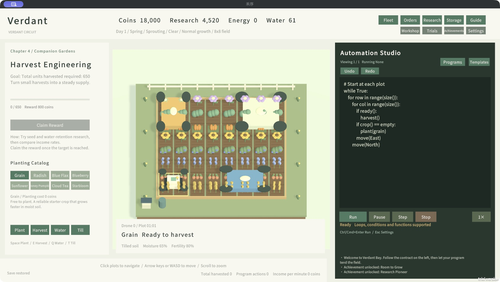

<div align="center">

# Verdant Circuit · 禾序

**Write the routine. Grow the system.**

A single-player programming farm: grow eight crops, build a drone fleet, and turn repeated work into an automated production system.

**English** · [简体中文](README.zh-CN.md)

[Download v0.10.2](https://github.com/13536309143/verdant-circuit/releases/tag/v0.10.2) · [Fleet & economy guide](docs/FLEET.md) · [Changelog](CHANGELOG.md) · [Report an issue](https://github.com/13536309143/verdant-circuit/issues)


</div>



Start with a free grain crop and one drone. Learn loops, soil preparation, water management and companion planting; then coordinate several machines with different physical footprints. The game uses a small Python-inspired language, with visible execution state, sensors and an editable program library.

**v0.10.2 is a public test release.** Multiple drones and large airframes are playable. Floating islands and inter-island logistics remain future work. The game defaults to English; choose Simplified Chinese in **Settings → Language**, or press **F8**. Your choice persists, and your own code is never translated.

## What you can play

| System | Included |
|---|---|
| Farm | 4×4 → 6×6 → 8×8 fields; seasons, rain, moisture and fertility |
| Crops | Grain, radish, flax, berry, sunflower, pumpkin, tea and starbloom |
| Progression | Six chapters, 30 contracts, 26 research projects, 12 achievements |
| Fleet | Capacity 1 → 2 → 4 → 8; general, irrigation and harvesting drones |
| Airframes | 1×1, 2×2, 3×2, 2×3 and 3×3; full-footprint collision checks |
| Scheduling | One controller program, concurrent per-drone FIFO queues, local pathfinding and waiting |
| Economy | Harvest income, five processing recipes, three rotating supply orders, active-fleet upkeep |
| Challenges | Six separate timed trials; main-farm resources are restored afterward |
| Code studio | Eleven templates, current-line/variable display, pause/step, 100-state undo/redo per program |
| Programs | Start with one; add/remove freely, keep at least one; browsing preserves the running program |
| Saves | Autosave, manual save, rolling backup and recovery; old saves migrate to a one-drone fleet |

Crop contracts count **new harvests after accepting that contract**. There is no fixed 600-second gate. Targets are grain 2,000; radish 1,000; flax 1,400; berry 2,400; sunflower 1,300; pumpkin 1,200; tea 1,250; starbloom 500. Better algorithms, research and fleets can shorten completion time.

## Download and run

Open [Releases](https://github.com/13536309143/verdant-circuit/releases/tag/v0.10.2). You do not need Unity to play.

| Platform | Download | Launch |
|---|---|---|
| macOS Intel + Apple Silicon | `HeXu-macOS-0.10.2.zip` | Extract and open `HeXu-0.10.2.app` |
| Windows x64 | `HeXu-Windows-x64-0.10.2.zip` | Extract the **whole folder**, then open `HeXu.exe` |
| Unity source project | `HeXu-UnityProject-0.10.2.zip` | Extract and add the project root in Unity Hub |

Keep `HeXu_Data`, `UnityPlayer.dll` and `MonoBleedingEdge` beside the Windows executable. Verify downloads against `SHA256SUMS-0.10.2.txt` when needed. Save and quit the old game before opening an upgrade. v0.10.1 remains available separately.

The macOS app is locally built and has not been distribution-signed or notarized. The Windows Mono build is cross-compiled on macOS and is not yet validated on a native Windows machine. Linux, WebGL and Steam distributions are not provided.

## Your first program

Use arrows/WASD to move, Space to plant and **E** to harvest. Start with grain, then paste this into the studio and click **Run**:

```python
while True:
    for row in range(size()):
        for col in range(size()):
            if ready():
                harvest()
            if crop() == empty:
                plant(grain)
            move(East)
        move(North)
```

Claim each completed contract on the left to advance. Research unlocks crops and better tools. For the watering contract, use the **Irrigation patrol** template (`moisture() < 0.6`); stored water and plot moisture are different measurements.

| Action | Control |
|---|---|
| Move / navigate | Arrows or WASD / click a plot |
| Plant / harvest | Space / E |
| Water / till / fertilize | Q / T / F, after the relevant unlock |
| Run | Cmd/Ctrl+Enter |
| Undo / redo | Cmd/Ctrl+Z / Cmd/Ctrl+Shift+Z or Ctrl+Y |
| Programs, fleet, research | Header and studio buttons; F7 opens Fleet |
| Settings / close panel | Esc |
| Change language | Settings → Language, or F8 |

Typing takes priority over farming shortcuts. Settings and research panels pause the world; program, fleet and airframe panels keep it running. Pausing the controller also pauses fleet queues, while crops continue growing. Stop clears queued jobs. Finishing a controller naturally leaves its submitted jobs running. Loading a save restores jobs **paused**: resume them explicitly from Fleet.

## Build a fleet

Research **Dual-Drone Scheduling**, then deploy a second general drone from **Fleet**. Capacity and footprint level are independent saved variables: `droneCapacity` and `footprintTier`. Size research does not grant more machines; capacity research does not grant larger bodies.


Queued work moves the full rectangular footprint to its anchor, then acts on each covered plot. Queue routes wait for occupied space; manual/direct movement into another machine incurs a capped repair fee. Large bodies cannot wrap around field edges. Leave space for passing and use separate work lanes.

```python
# Requires two deployed general drones in clear lanes.
left = drone_id(0)
right = drone_id(1)
queue_plant(left, grain, 0, 0)
queue_plant(right, grain, size() - drone_width(right), 0)
while drone_busy(left) or drone_busy(right):
    wait(0.2)
```

These are void commands, not Python threads or promise/ticket APIs. One VM dispatches work; each machine advances its own queue. The [fleet guide](docs/FLEET.md) gives exact costs, unlocks, complete API signatures, scheduling limits and a repeatable internal acceptance test.

## Open and build the Unity project

Use the editor version in `ProjectSettings/ProjectVersion.txt`: **Unity 2022.3.62f3c1**. Other 2022.3 versions require compatibility checks. Install Mac Build Support and/or Windows Build Support (Mono) for that same Editor, with an active Unity license.

```bash
git clone https://github.com/13536309143/verdant-circuit.git
cd verdant-circuit
```

Add the repository root in Unity Hub and open `Assets/VerdantCircuit/Scenes/VerdantCircuit.unity`. Let Package Manager finish before pressing Play. Dependencies include **Unity Localization 1.5.3** and Addressables, pinned in `Packages/`. Unity MCP is an optional development integration; the project and players do not require it.

Use **Tools → 禾序 → 发行** to generate localization assets, run regression checks, and build either platform. For command-line builds, close the Editor for this project first:

```bash
export VERDANT_UNITY_EDITOR="/path/to/Unity.app/Contents/MacOS/Unity"
bash tools/build-macos.sh
bash tools/build-windows.sh
```

The scripts regenerate bilingual tables/fonts, verify rules and the campaign, build, zip and checksum into `Builds/release/`. They do not upload releases or perform signing/notarization. Share the complete package through GitHub Releases; this is a local single-player application and needs no backend deployment. Do not run a standalone player and Editor Play against the same save simultaneously.

## Validation and limits

The release checks exercise the actual Unity game model: **45 fleet checks**, **50 core checks**, all 30 campaign contracts, compilation of all eleven templates and both localization tables. Fleet coverage includes independent unlocks, area billing, roles, saves, insufficient funds, capped collision fees and 1,000 scheduling ticks with eight mixed-size bodies. Real Play-mode checks also verify advancing frames, both UI languages and completed queued irrigation. Reports are in [docs/reports/v0.10.2](docs/reports/v0.10.2/).

The campaign replay is a deterministic reachability check, not a promise of human playtime or final balance. Queue pathfinding respects current occupancy; it does not guarantee resolution of every packed layout. A blocked job expires after 30 game seconds so the controller can replan. Native Windows testing, prolonged human balance testing and a wider hardware matrix remain outstanding. The old standalone Python fleet/island model under `tools/` is a historical design prototype, not the implementation used by this release.

## Saves and source layout

The original product name is retained to preserve save compatibility. macOS commonly uses either of these compatibility locations; **Settings → Save location** shows the exact path in use:

```text
~/Library/Application Support/Fieldworks/禾序/verdant-farm.json
~/Library/Application Support/com.fieldworks.verdantcircuit/verdant-farm.json
```

Windows uses Unity's `Application.persistentDataPath` under the current user's LocalLow directory (`Fieldworks/禾序`). `.bak` holds the previous save. A new campaign creates a dated backup. Existing programs and completed contracts are preserved; new fleet research is earned normally.

```text
Assets/VerdantCircuit/
  Scripts/       Farming, VM, fleet, economy, runtime UI and localization
  Editor/        Scene generation, release builders and automated checks
  Localization/  English/Chinese String Tables, Asset Tables and authoring JSON
  Scenes/        Main game scene
  Fonts/         Bundled CJK source and TMP font assets
Packages/        Pinned dependencies
ProjectSettings/ Unity project configuration
docs/            Guides, screenshots, test reports and roadmap
tools/           Reproducible build scripts and historical rule prototype
```

## Credits and contribution

Inspired by programming-farm games as a genre. This project does not use the source code, branding or art of *The Farmer Was Replaced*. Geometry, UI and synthesized audio are implemented in this project. Fonts and engine packages retain their own licenses; see [third-party notices](THIRD_PARTY_NOTICES.md). No project-wide open-source license has been selected; a public repository does not itself grant additional rights.

For issues, include the release, OS/chip, reproduction steps, expected/actual behavior and a short program if relevant. Avoid posting private paths, player saves or credentials. Run rule checks after changing gameplay, and check real keyboard/mouse interaction after changing UI.
