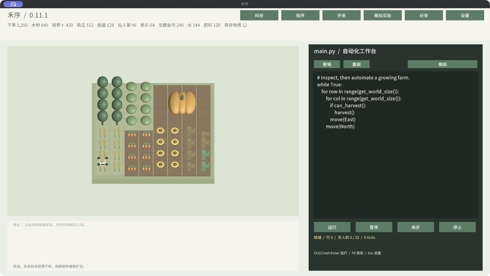

# 禾序 · Verdant Circuit

**写下程序，发现农场背后的算法。**

[English](README.md) · **简体中文** · [下载 0.11.1](https://github.com/13536309143/verdant-circuit/releases/tag/v0.11.1) · [完整内部测试](docs/TESTING.md)

0.11.1 是全新自动化农场：语言运行系统、资源经济、科技进度、界面和存档重新开发，从一格、零物资开始。原来的委托、金币／研究点和大型机体队列模式已由新系统替换。旧发行仍保留在 Releases 和 Git 标签中。

本项目参考编程农场类型的机制，代码、几何造型、音效及说明独立实现。**不是 Steam 原程序的搬运包**；本项目的研究价格、计时规则、界面和本地竞速目标按本仓库实现定义。[功能对照与边界](docs/PARITY-0.11.1.md)



## 本版内容

| 系统 | 玩法 |
|---|---|
| 基础生产 | 草、灌木、树、胡萝卜，以及干草、木材等生产物资 |
| 巨型南瓜 | 方阵成熟合并、枯死格补种、区域收获 |
| 仙人掌 | 测量尺寸、交换邻格、二维排序与连锁收获 |
| 向日葵 | 测量花瓣、择优收获、能量加速与执行消耗 |
| 伴生 | 查询植物偏好的类型和目标坐标，安排混合生产 |
| 肥料与感染 | 催熟、感染、产物变化及邻域翻转治疗 |
| 迷宫 | 生成树篱、探索宝藏、复用布局及打开捷径 |
| 长尾 | 苹果目标、增长尾巴、避开自身、收获骨头 |
| 无人机 | 各机独立执行函数、变量及集合副本隔离、等待返回值；机器之间不碰撞 |
| 研究 | 33 项物资科研与多级升级，查询成本和自动研究 |
| 编程 | 参数、默认值、返回值、递归、闭包、模块、列表／元组／字典／集合、索引及解包 |
| 编辑器 | 多程序、可拖动代码窗口、100 状态撤销重做、断点、暂停单步、变量观察及悬停 |
| 实验 | 固定种子模拟、独立竞速农场、个人最佳、本地纪录和成就 |
| 文件 | 独立存档与备份、外部 `.py` 编辑、接口提示、文件监视和输出日志 |

游戏默认英文，**F8** 或设置切换简体中文。玩家自己的代码保留原文。

## 下载和启动

[发行页](https://github.com/13536309143/verdant-circuit/releases/tag/v0.11.1)提供：

- `HeXu-macOS-0.11.1.zip`：解压运行 `HeXu-0.11.1.app`，支持 Intel 与 Apple Silicon。
- `HeXu-Windows-x64-0.11.1.zip`：完整解压整个文件夹，运行 `HeXu.exe`；保留旁边的数据文件、DLL 和 Mono 目录。
- `HeXu-UnityProject-0.11.1.zip`：完整 Unity 源码工程。

玩发行包无需 Unity 或 MCP。Mac 包未完成发行签名和公证；Windows 包在 Mac 上交叉构建，仍需 Windows 真机验收。可用发行校验和验证下载文件。

## 从零怎么玩

1. 等起始地块的草成熟，运行 `harvest()` 收获干草；未成熟时没有产出，等待几秒后再试。
2. 凑够物资研究“循环”，然后载入“第一份收获”模板，让程序持续收割。
3. 研究种植、扩田、运算符、变量、传感器，逐步获得更多表达能力。
4. 生产木材、胡萝卜、南瓜等物资，解锁新的生产系统。
5. 针对排序、迷宫和长尾编写不同算法，再用模拟和竞速比较效率。

循环研究后可运行：

```python
while True:
    harvest()
```

解锁相应语言与农田后，可使用整田巡查：

```python
while True:
    for row in range(get_world_size()):
        for col in range(get_world_size()):
            if can_harvest():
                harvest()
            move(East)
        move(North)
```

设置中的“允许未解锁语法”用于自由练习；作物的实际科技与物资成本仍然需要满足。九个模板覆盖巡田、林地、南瓜、排序、迷宫、并行、自动科研和长尾路线，需按提示准备田地和物资。

## 操作和运行规则

| 操作 | 方法 |
|---|---|
| 运行 | 工作台按钮／Cmd/Ctrl+Enter |
| 暂停、单步、停止 | 工作台按钮 |
| 撤销／重做 | Cmd/Ctrl+Z／Cmd/Ctrl+Shift+Z，或 Ctrl+Y |
| 断点 | 光标所在行按 F9，或设置中填写行号 |
| 变量 | 观察栏，或鼠标悬停代码变量 |
| 程序与模块 | 程序列表新增、查看、删除；`import 文件名` |
| 浮动窗口 | 程序列表选择“窗口”，拖动标题移动 |
| 查看地块／缩放 | 点击农田／在农田上滚轮缩放 |
| 设置／关闭面板 | Esc |
| 切换语言 | F8 |

查看别的程序不会停止执行。主工作台运行会重启控制程序；浮动窗口可在数量允许时独立启动另一个程序。停止会结束所有任务。工作机函数完成后消失，任务句柄仍可用于取回结果。读档后由玩家主动运行程序，不恢复解释器执行栈。

## 并行、模拟和竞速

```python
def calculate(amount):
    return amount * 2

worker = spawn_drone(calculate, 7)
if worker != None:
    answer = wait_for(worker)
    print(answer)
```

每台机器的变量与集合隔离，但共同操作农田与库存；代码仍可能产生地块操作先后的竞态。数量不足时 `spawn_drone()` 返回 `None`，可以由当前机器执行备用方案。

创建名为 `experiment` 的程序后，另一个程序可以运行：

```python
duration = simulate("experiment", Unlocks, {Items.Carrot: 10000}, {}, 7, 64)
print(duration)
```

模拟使用独立状态，相同种子复现开局，返回游戏耗时。模拟与竞速有一小时游戏时间的执行限制，不支持嵌套模拟。本地资源竞速目标为**新增生产 1000 份，随后让程序结束**；另有最快重置目标。成绩及成就保存在本机，Steam 接入留待后续。

## 存档与外部编辑器

本版使用新存档，不迁移旧农场进度。设置页显示真实路径：

```text
Unity 持久化目录/Automation/<farm>.json
```

设置 → 农场列表 → 管理可创建和载入独立农场，各自保留进度、程序和纪录。默认文件为 `farm-0.11.1.json`。`.bak` 保留上一份存档。设置中选择“外部编辑器 → 导出并监视”，会导出 `.py` 程序和 `__builtins__.py` 接口提示；外部保存后重新载入。不要同时在两处修改同一文件。请在游戏程序列表中删除程序。

`output.txt` 保存近期输出，程序内容和纪录随农场存档保存。新建农场前会保存当前状态与备份。

## 打开工程和构建

使用 **Unity 2022.3.62f3c1**，安装同版本 Mac Build Support／Windows Build Support（Mono）及有效许可。Localization 与 Addressables 已锁定在 `Packages/`，首次打开等待依赖导入。

```bash
git clone https://github.com/13536309143/verdant-circuit.git
cd verdant-circuit
```

Unity Hub 添加仓库根目录，打开 `Assets/VerdantCircuit/Scenes/VerdantCircuit.unity`，点击 Play。新实现位于 `Assets/VerdantCircuit/Scripts/Automation/`。

关闭此项目的 Editor 后，可构建：

```bash
export VERDANT_UNITY_EDITOR="/你的Unity路径/Unity.app/Contents/MacOS/Unity"
bash tools/build-macos.sh
bash tools/build-windows.sh
```

脚本生成双语资源、执行回归、构建并打包，输出 `Builds/release/`；不会自动签名、公证或上传。也可使用 **Tools → 禾序 → 发行**。本版是单机游戏，不需要部署后台。

完整测试代码、顺序、验收条件见 [测试手册](docs/TESTING.md)。字体及引擎组件许可见 [第三方说明](THIRD_PARTY_NOTICES.md)。本仓库尚未指定统一开源许可证。
