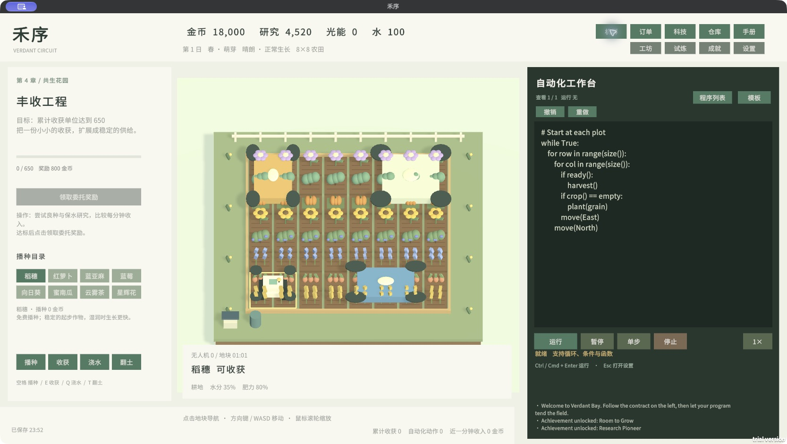

# 禾序 · Verdant Circuit

**把重复劳动写成程序，让农场自己运转。**

[English](README.md) · **简体中文** · [下载 0.10.2](https://github.com/13536309143/verdant-circuit/releases/tag/v0.10.2) · [机群与经济手册](docs/FLEET.md) · [更新日志](CHANGELOG.md)



禾序是一款单人编程农场游戏。通过循环、条件和函数照看八种作物，再用一个中央程序协调多台、不同占地的无人机。**0.10.2 已接入可玩的机群与大型机体**；浮空岛与跨岛物流仍在后续计划中。

游戏默认英文，在 **Settings → Language** 或按 **F8** 切换简体中文；选择会保留，玩家自己的代码不会被翻译。0.10.1 发行保留。

## 本版内容

- 4×4、6×6、8×8 农田；四季、降雨、水分、肥力、间作与光能。
- 8 种作物、6 章 30 份主线、26 项研究、12 项成就。
- 无人机上限 1→2→4→8，独立解锁 1×1、2×2、3×2、2×3、3×3 机体。
- 通用机、浇水机和收获机；每机最多 64 项队列、完整占地避让与分区生产。
- 6 项独立试炼、5 种加工配方、3 个动态订单槽。
- 11 个程序模板；执行行、变量、暂停、单步；每程序 100 状态会话撤销/重做。
- 默认一个程序，可增删且至少保留一个；切换查看不会停止执行，运行新程序替换当前 VM。
- 自动保存、备份恢复及旧存档迁移。旧进度不赠送新增机群科技。

作物任务按**接取后的新增收获**结算，没有 600 秒硬性等待。稻穗 2000、萝卜 1000、亚麻 1400、蓝莓 2400、向日葵 1300、南瓜 1200、茶 1250、星辉花 500。算法、科技与机群可以缩短生产时间。

## 下载与启动

在 [0.10.2 发行页](https://github.com/13536309143/verdant-circuit/releases/tag/v0.10.2) 下载：

| 包 | 使用方法 |
|---|---|
| `HeXu-macOS-0.10.2.zip` | 解压运行 `HeXu-0.10.2.app`，支持 Intel 和 Apple Silicon |
| `HeXu-Windows-x64-0.10.2.zip` | 整个文件夹解压后运行 `HeXu.exe`，保留旁边的数据、DLL 和 Mono 文件夹 |
| `HeXu-UnityProject-0.10.2.zip` | 源码工程，用 Unity Hub 添加解压后的根目录 |

玩发行包无需 Unity 或 MCP。升级前先保存并退出旧版；可用发行页校验和检查下载。macOS 包尚未发行签名或公证。Windows 是在 Mac 上交叉构建的 Mono x64 包，尚未在 Windows 真机验证。未提供 Linux、WebGL 或 Steam 版。

## 怎么玩

先用方向键/WASD 移动，空格播种免费稻穗，E 收获。将下面代码粘贴进工作台并运行：

```python
while True:
    for row in range(size()):
        for col in range(size()):
            if ready():
                harvest()
            if crop() == empty:
                plant(grain)
            move(East)
        move(North)
```

满足左侧目标后主动领奖，每五份委托进入下一章。科技消耗金币和研究点；萝卜需翻土，蓝莓和茶需灌溉，星辉花需要光能。“水的节奏”使用“灌溉巡田”模板，阈值为 `moisture() < 0.6`；顶部水仓余额与地块水分是两个指标。

| 操作 | 快捷键 |
|---|---|
| 移动／导航 | 方向键或 WASD／点击地块 |
| 播种／收获 | 空格／E |
| 浇水／翻土／施肥 | Q／T／F，需相应解锁 |
| 运行 | Cmd/Ctrl+Enter |
| 撤销／重做 | Cmd/Ctrl+Z／Cmd/Ctrl+Shift+Z 或 Ctrl+Y |
| 设置／关闭面板 | Esc |
| 打开机群 | F7 |
| 切换语言 | F8 或设置页 |

输入代码时优先处理文字。科技和设置面板暂停世界；程序列表、机群和规格面板保持世界运行。暂停程序也暂停机群队列，作物仍生长；停止会清空队列。程序自然结束后已提交队列继续执行。读档恢复队列但保持暂停，请到机群页继续。

## 机群与经济

先研究“双机调度”，在顶部“机群”部署第二台通用机，再载入“双机分区”模板。数量 `droneCapacity` 与规格 `footprintTier` 分开保存、分开研究。通用机能进行农耕，专用机只进行对应作业，但队列作业间隔为通用机的 55%。

大型机体覆盖真实矩形区域，逐格扣种子／水、结算收获。队列检查整个占地，遇堵等待；直接移动碰撞扣 20 金币，每 10 游戏秒最多两次。大型机体不能跨边界环绕。堵塞超过 30 游戏秒会取消当前任务，需调整路径。规划工作条带与通道能提高效率。

0 号基础机免维护，其他机仅在队列活动时收费；空闲免费，余额不足暂停，不欠债。免费稻穗与基础机保留恢复收入的途径。收获价格、研究产出和订单奖励已重新校准；高级机群是可选择的持续投资。

[机群与经济手册](docs/FLEET.md)列出所有接口、精确费用、解锁表、可复制代码和内部验收顺序。当前接口是 `queue_move(id,x,y)` 等直接调用，不是路线图旧稿中的任务票据接口。

## 开发、构建与发布部署

使用 `ProjectSettings/ProjectVersion.txt` 指定的 **Unity 2022.3.62f3c1**。安装同版本 Mac Build Support、Windows Build Support（Mono）及有效许可。依赖包括 Unity Localization 1.5.3 与 Addressables，首次打开需完成下载。Unity MCP 是可选开发工具，无需启动服务即可打开和构建本项目。

```bash
git clone https://github.com/13536309143/verdant-circuit.git
cd verdant-circuit
```

Unity Hub 添加仓库根目录，打开 `Assets/VerdantCircuit/Scenes/VerdantCircuit.unity`，点击 Play。不要让独立游戏与 Editor 同时写同一存档。

在 **Tools → 禾序 → 发行** 中生成双语表与字体、运行回归、构建 Mac 或 Windows。命令行需先关闭此工程的 Editor：

```bash
export VERDANT_UNITY_EDITOR="/你的Unity路径/Unity.app/Contents/MacOS/Unity"
bash tools/build-macos.sh
bash tools/build-windows.sh
```

脚本生成语言资源、回归测试、构建、打包并计算校验和，输出 `Builds/release/`；不自动签名、公证或上传。将完整压缩包上传 GitHub Releases 即完成单机游戏分发，不需要服务器。

## 验证与存档

本版有 45 项机群检查、50 项基础检查、30 份主线回放、11 模板编译和双语表完整性检查。另有真实 Play 帧验证中英文界面、机群画面和队列灌溉。[查看报告](docs/reports/v0.10.2/)。验证说明可达性，不能替代长期真人平衡测试或各系统真机验证。

macOS 存档有以下兼容目录，以游戏“设置 → 存档位置”显示为准：

```text
~/Library/Application Support/Fieldworks/禾序/verdant-farm.json
~/Library/Application Support/com.fieldworks.verdantcircuit/verdant-farm.json
```

Windows 位于当前用户 LocalLow 下的 `Fieldworks/禾序`，由 Unity 的持久化目录决定。`.bak` 是上一份备份；新建农场会额外生成日期备份。原来的研究、程序与已领任务保留。

项目文件结构、英文说明和贡献要求见 [English README](README.md)。字体与 Unity 包保留各自许可，见 [第三方说明](THIRD_PARTY_NOTICES.md)。未使用 Steam 原作代码、美术或品牌；本仓库尚未指定统一开源许可证。
