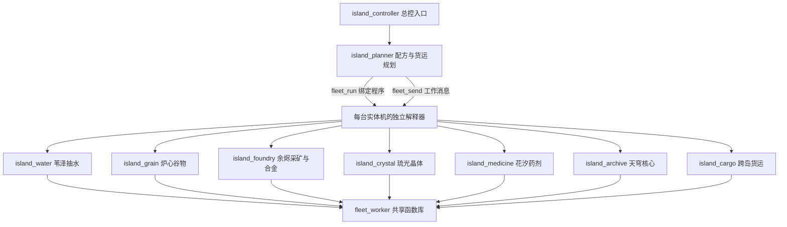

# 禾序 0.12.1：群岛机队与多程序控制测试手册

本版在农场研究之外，加入6座岛屿、7类群岛物资、8个本地配方、6类专用机体、5档占地、独立的3—8台机队研究、18单多目标订单，以及15.5秒可跳过的双语开场动画。

## 从哪里开始

1. 使用 **0.12.1** 应用或本仓库 Unity 项目。已发布的0.11.3应用不会自动包含本次源码更新。开场可按Esc、空格、Enter或点击跳过；设置中可重播。播放时农场时钟、机队和脚本都暂停推进，结束后恢复原状态。
2. 主农场按同包 `BASE-FARM-GUIDE.zh-CN.md` 完成分段开局。正常流程可在发现胡萝卜后进入群岛；完整复现测试建议先完成农场科技，再启动群岛控制器。保持未解锁语法关闭。
3. 群岛控制器需要循环、运算符、变量、函数、列表、字典、导入、调试和计时研究。准备 **100木材＋100胡萝卜**；主界面左侧“群岛”→签署开拓许可，正常支付原料，一次性获得100机队资金。
4. 群岛界面点击 **创建模块化范例（10个文件）**，会创建总控、规划器、共享库和七种单机程序。保留现有同名文件，不覆盖你的修改。切回主编辑器，运行 `island_controller`。
5. 也可将压缩包全部35个`.py`复制到“设置→外部编辑器→导出并监视”显示的当前农场程序文件夹。文件名称不变；不要放入Unity的Assets，也不要用系统Python执行。
6. 开拓许可若已签署，代码不会重复付费。以后可查看群岛界面的实时库存、订单清单、程序绑定和货物流向。切换查看文件不会停止总控。

## 三层代码结构



- `import` / `from ... import ...`：同步调用子文件中的函数，参数和返回值遵循现有类Python规则。
- `fleet_run(机体编号, "文件名")`：在实体机上启动独立程序，自动提供 `unit_id`、启动时的 `island_id`；`fleet_self()`随时返回本机编号。
- `fleet_send(编号, 数据)` / `fleet_receive()`：复制消息数据，发送到最多16条的单机收件箱；空箱返回None。各机体的变量与导入模块互相独立。
- `fleet_units()`：查看任务数、绑定程序、是否运行、收件箱、错误、待交货物和在制品。`fleet_result(id)`读取已结束子程序的`result`变量副本。
- 某台机器代码报错不会停止其他机器。停止代码不取消物理任务；取消队列会退回预留材料，航行中的机体须先降落。

默认总控先展开订单的配方依赖，再给各岛工作机和货运机发送消息。你可以改写某一岛的子程序，也可以完全换掉规划器；不用把整个世界写在一个大循环里。

## 每座岛做什么

| 编号 | 岛屿 | 本地生产 | 必需机型 | 开放条件（已完成订单数＋主农场发现） |
|---|---|---|---|---|
| 0 | 炉心花园 Hearth | 谷物；早期抽水 | 种植／采收；灌溉 | 开拓许可＋胡萝卜 |
| 1 | 苇泽水库 Reed | 高效抽水 | 灌溉 | 2单＋南瓜 |
| 2 | 余烬工坊 Ember | 矿石、合金 | 工程 | 5单＋仙人掌 |
| 3 | 琉光礁 Glass | 晶体 | 侦察 | 8单＋迷宫 |
| 4 | 花汐温室 Bloom | 药剂 | 种植 | 11单＋长尾 |
| 5 | 天穹档案馆 Zenith | 核心 | 工程 | 14单＋自治信标 |

谷物消耗水；合金消耗矿石、谷物、水；晶体消耗合金、水；药剂消耗谷物、晶体、水；核心消耗合金、晶体、药剂。各岛设施共享本岛仓库，**跨岛必须预留、装载、航行、卸货**。主农场的 `Items.Water` 与群岛字符串货物`"water"`是两套库存。

连接：0—1、0—2、1—2、1—3、2—3、2—4、3—4、3—5、4—5。没有直连的目的地需要经过中转航段。`fleet_map(岛号)`返回地形、配方与航路，地图行顺序从下到上。

## 数量、尺寸、类型分别解锁

- 数量：初始3台；`fleet_research("slots")` 每次增加1台，上限8。对应已完成订单门槛2、4、6、8、10；价格30、50、70、90、110机队资金。
- 尺寸：`fleet_research("size")`依次开放2×1、2×2、3×2、3×3，已完成订单门槛3、6、11、15；价格35、60、85、110。可建造旋转尺寸，例如1×2、2×3。
- 类型：灌溉、种植、运输默认开放；工程需要已完成5单，侦察8单，采收6单，各支付35资金。
- 建造价：`10＋5×机体面积`；运输机货舱为`12×面积`。加工按机体面积预留原料并产出，较大的机体移动较慢，不能穿窄缝。
- 早期灌溉、谷物、货运各1台即可开始。之后要在生产岗位和运输岗位之间分配槽位。范例最终用6台生产机＋2台运输机。

图上方框显示真实占地。宽桥组成单向环路，小机体保留窄道捷径；不同岛的桥位与障碍有所区别。路径检查整个机体，不允许重叠，也不允许两机迎面穿过。自动队列等待不收费；危险的手动`fleet_step`触发急停，单次维修费最多2资金，冷却期间不会逐帧重复扣费。

## 怎样完成订单

每单清楚列出 **目的岛／物品／当前可用库存／目标数量**，所有目标须同时满足，点击全部交付或调用 `fleet_submit()` 后只扣一次，奖励资金并开放下一单。

后续清单同时显示本单实际使用的机体面积、不同子程序并发峰值和同时航行峰值。部分订单要求2×1、2×2、3×2或3×3实际作业；后期至少3种子程序并发；第5、11、17单还要求两台机器同时航行。没有600秒认证或按秒数放行的条件。

若订单涉及的岛尚未开放，检查主农场对应发现。若物资似乎够却交不了，检查**在途与已预留货物不算可用库存**，以及额外的机体／程序／航行清单。

## 手写一个简单的跨岛调用

先创建单机文件 `my_water`：

```python
from fleet_worker import run
run(["water"])
```

总控中调用（须已开放苇泽、有对应研究和资金）：

```python
water_drone = fleet_build("irrigator",1,1,1)
if water_drone > 0:
    fleet_run(water_drone,"my_water")
    fleet_send(water_drone,["work",1,"water",8])
```

货运子程序可写为 `from fleet_worker import run` 后调用 `run(["cargo"])`。总控用 `fleet_send(运输机编号,["ship",1,0,"water",24])` 发起运输；源仓须已有24水。也可以直接调用 `fleet_ship`，其接受指令时会原子预留真实源仓物资。

## 出口、维修与资金恢复

自动队列等待不扣维修费，危险手动移动才触发急停。资金不会变负数。若维修费让你暂时买不起下一项研究，可用已有机体继续生产，然后在群岛底部点击“出售12份”，出售当前岛、当前选中货物的可用库存；也可调用 `fleet_sell(岛号,"water",数量)`。已预留与在途货物不能重复出售。

每份价格：水0.05、谷物0.2、矿石0.1、合金0.5、晶体1、药剂1.5、核心4机队资金。`fleet_market()`返回价格表。出口真正扣除物资，订单发现仍须正常交付，不能靠卖货跳过研究条件。

机队卡片第二行依次显示状态／任务条数／载货数量／绑定程序，▶表示子程序正在运行。货单预留后，源仓可用数先下降；机体实际装货后载货数才增加。

## 可选：让各岛自己运行，不依赖总规划器

同包 `examples` 另有6个完整文件。已开放前三岛后，先全部停止，并留出至少4个空机队槽位，把6个文件一起导入，运行 `local_master`。它建造并启动抽水、谷物、采矿／冶炼、循环货运4台机器，然后主程序结束。各岛子程序仍会独立检查库存、加工与补给；你可以在主编辑器运行其他代码。

`local_common`提供共享查询函数，`local_water`、`local_grain`、`local_forge`、`local_cargo`各管一项职责。它们不会自动交订单，适合测试你自己的群岛算法。这套例子也经过真实解释器验证：主程序结束后，三岛网络仍能产出合金且账本一致。

## 存档与重启

保存机体、岛仓、配方计时、已预留原料、货运清单、在途货物、订单和资金账本；加载后物理队列继续。与主农场一致，**不保存正在执行的Python调用栈**；单机消息箱和返回对象也不保存。载入后重跑总控，它会读取现有任务，避免重复发送，并重新启动各单机程序。也可选择机体，选择自定义文件，再点击“绑定并运行”。

运行中的单机程序及其正在导入的共享库，在程序卡片中显示活跃状态，并禁止删除。你可以编辑后明确重启绑定的程序。

## 验收顺序

1. 新建测试农场，按基础手册完成开局与农场科技，保留你自己的其他存档。
2. 正常生产开拓许可的材料，导入35文件并运行`island_controller`。
3. 核查3→8数量、五档机体、三种新增机型均需单独支付与订单进度。
4. 观察至少一次窄桥拒绝大机体、宽桥排队、满载跨岛和等待降落。自动控制不应产生维修费。
5. 在加工中保存重载，产出不重复；在航行中保存重载，货物不丢失不重复。重启总控后子程序继续工作。
6. 给一台机绑定故意报错的测试文件，确认错误显示在该机卡片，其他机器继续；随后重新绑定正确程序。
7. 完成18单，输出`archipelago_complete True`，主工作台目标显示“禾序协约”。
8. 基础七机制、16类竞速和13项农场成就按基础手册回归。开场检查跳过、重播、双语和恢复原暂停状态；编辑器检查光标、选区、撤销与数字／中文命名。

自动验证只证明已覆盖的路线与异常场景；不同硬件、玩家自写算法和极限并发仍可发现新问题。Windows包由Mac交叉构建，需另做Windows真机运行验收。

## 全部群岛程序

以下10个文件已经包含在代码包里；基础农场的25个文件见同包基础手册。

### island_controller

```python
import island_planner
island_planner.run_coordinator()
```

### island_planner

```python
# Requires Functions, Dictionaries, Lists, Operators, Variables, Timing and Debug.
# Signs the charter with real farm resources, then automates all 18 island orders.
# Every queued job uses physical machines, local depot inputs and ordinary credit costs.
# View Archipelago / Operations to watch the network and the current order.

def provider(item, opened):
    if item == "water":
        if opened > 1:
            return 1
        return 0
    locations = {"grain":0, "ore":2, "alloy":2, "crystal":3, "medicine":4, "core":5}
    return locations[item]

outputs = {"water":6, "grain":2, "ore":2, "alloy":2, "crystal":2, "medicine":2, "core":1}
inputs = {"water":{}, "grain":{"water":1}, "ore":{}, "alloy":{"ore":2,"grain":1,"water":1}, "crystal":{"alloy":1,"water":2}, "medicine":{"grain":2,"crystal":1,"water":1}, "core":{"alloy":2,"crystal":2,"medicine":1}}
order_items = ["core","medicine","crystal","alloy","ore","grain","water"]
roles = ["irrigator","grower","engineer","scout","grower","engineer"]
sizes = [(1,1),(2,1),(2,2),(3,2),(3,3)]

def run_coordinator():
    if not fleet_start():
        print("Charter needs Carrots research, 100 Wood and 100 Carrots.")

    while fleet_state()["started"] and not fleet_state()["complete"]:
        # Slot count, hull size and specialisms are independent paid research tracks.
        while fleet_research("slots"):
            pass
        while fleet_research("size"):
            pass
        for kind in ["engineer","scout","harvester"]:
            fleet_research(kind)
        state = fleet_state()
        opened = state["islands"]
        tier = state["size_tier"]
        width,height = sizes[tier]
        units = fleet_units()
        hauler_count = 0
        for unit in units:
            if unit["role"] == "hauler":
                hauler_count += 1
        if "harvester" in state["roles"]:
            for unit in units:
                if unit["role"] == "grower" and unit["island"] == 0 and unit["jobs"] == 0 and not unit["flying"]:
                    fleet_remove(unit["id"])
            units = fleet_units()
        grain_role = "grower"
        if "harvester" in state["roles"]:
            grain_role = "harvester"
        used = set()
        workers = {}
        # One machine runs both ore and alloy recipes on Ember.
        for location in range(opened):
            if location == 1:
                continue
            role = roles[location]
            destination = location
            if location == 0:
                for water_role in ["irrigator",grain_role]:
                    destination = provider("water",opened)
                    if water_role != "irrigator":
                        destination = 0
                    candidate = None
                    for unit in units:
                        if unit["role"] == water_role and unit["id"] not in used and (water_role == "irrigator" or unit["island"] == destination):
                            candidate = unit
                            break
                    if candidate == None and len(units) < state["slot_limit"]-max(0,1-hauler_count):
                        identifier = fleet_build(water_role,width,height,destination)
                        units = fleet_units()
                        for unit in units:
                            if unit["id"] == identifier:
                                candidate = unit
                    if candidate != None:
                        used.add(candidate["id"])
                        workers[(destination,water_role)] = candidate
            else:
                candidate = None
                for unit in units:
                    if unit["role"] == role and unit["island"] == destination and unit["id"] not in used:
                        candidate = unit
                        break
                if candidate == None and len(units) < state["slot_limit"]-max(0,1-hauler_count):
                    identifier = fleet_build(role,width,height,destination)
                    units = fleet_units()
                    for unit in units:
                        if unit["id"] == identifier:
                            candidate = unit
                if candidate != None:
                    used.add(candidate["id"])
                    workers[(destination,role)] = candidate
        # Upgrade only idle machines. Dismantling refunds the paid hull cost.
        for key in workers:
            worker = workers[key]
            if worker["jobs"] == 0 and not worker["flying"] and worker["width"]*worker["height"] < width*height:
                if fleet_remove(worker["id"]):
                    identifier = fleet_build(worker["role"],width,height,worker["island"])
                    for unit in fleet_units():
                        if unit["id"] == identifier:
                            workers[key] = unit
        units = fleet_units()
        while len(units) < state["slot_limit"] and hauler_count < 2:
            if fleet_build("hauler",width,height,0) < 0:
                break
            units = fleet_units()
            hauler_count += 1
        for unit in units:
            if unit["role"] == "hauler" and unit["jobs"] == 0 and not unit["flying"] and unit["width"]*unit["height"] < width*height:
                if fleet_remove(unit["id"]):
                    fleet_build("hauler",width,height,unit["island"])
        units = fleet_units()
        # Each physical machine runs its own named program with independent variables.
        for unit in units:
            if unit["program_running"]:
                continue
            file = "island_cargo"
            if unit["role"] == "irrigator":
                file = "island_water"
            elif unit["role"] == "grower" or unit["role"] == "harvester":
                file = "island_grain"
                if unit["island"] == 4:
                    file = "island_medicine"
            elif unit["role"] == "scout":
                file = "island_crystal"
            elif unit["role"] == "engineer":
                file = "island_foundry"
                if unit["island"] == 5:
                    file = "island_archive"
            fleet_run(unit["id"],file)
        demand = {}
        for goal in fleet_order()["goals"]:
            demand[(goal["island"],goal["item"])] = goal["amount"]
        expected = {}
        for unit in units:
            if unit["shipment_remaining"] > 0:
                key = (unit["shipment_target"],unit["shipment_item"])
                if key not in expected:
                    expected[key] = 0
                expected[key] += unit["shipment_remaining"]
            if unit["production_amount"] > 0:
                key = (unit["island"],unit["production_item"])
                if key not in expected:
                    expected[key] = 0
                expected[key] += unit["production_amount"]
        shipments = []
        production = {}
        # Gather every remote requirement before expanding a source recipe once.
        for item in order_items:
            source = provider(item,opened)
            if source >= opened:
                continue
            source_key = (source,item)
            for island in range(opened):
                key = (island,item)
                if island == source or key not in demand:
                    continue
                incoming = 0
                if key in expected:
                    incoming = expected[key]
                deficit = max(0,demand[key]-fleet_stock(island,item)-incoming)
                if deficit > 0:
                    shipments.append([source,island,item,deficit])
                    if source_key not in demand:
                        demand[source_key] = 0
                    demand[source_key] += deficit
            if source_key in demand:
                incoming = 0
                if source_key in expected:
                    incoming = expected[source_key]
                deficit = max(0,demand[source_key]-fleet_stock(source,item)-incoming)
                production[source_key] = deficit
                production_role = "engineer"
                if item == "water":
                    production_role = "irrigator"
                elif item == "grain" or item == "medicine":
                    production_role = "grower"
                    if item == "grain" and grain_role == "harvester":
                        production_role = "harvester"
                elif item == "crystal":
                    production_role = "scout"
                worker_key = (source,production_role)
                area = 1
                if worker_key in workers:
                    area = workers[worker_key]["width"]*workers[worker_key]["height"]
                batches = int((deficit+outputs[item]*area-1)/(outputs[item]*area))
                for raw in inputs[item]:
                    parent = (source,raw)
                    if parent not in demand:
                        demand[parent] = 0
                    demand[parent] += batches*area*inputs[item][raw]
        for key in workers:
            worker = workers[key]
            if worker["jobs"] != 0 or worker["inbox"] != 0:
                continue
            destination,role = key
            for item in ["water","grain","ore","alloy","crystal","medicine","core"]:
                task = (destination,item)
                allowed = role == "irrigator" and item == "water" or role == "grower" and item in ["grain","medicine"] or role == "harvester" and item == "grain" or role == "engineer" and item in ["ore","alloy","core"] or role == "scout" and item == "crystal"
                if task in production and production[task] > 0 and allowed:
                    ready = True
                    for raw in inputs[item]:
                        if fleet_stock(destination,raw) < inputs[item][raw]*worker["width"]*worker["height"]:
                            ready = False
                    if ready:
                        fleet_send(worker["id"],["work",destination,item,1])
                        break
        reserved = {}
        for unit in units:
            if unit["role"] != "hauler" or unit["jobs"] != 0 or unit["inbox"] != 0:
                continue
            for request in shipments:
                source,destination,item,needed = request
                key = (source,item)
                if key not in reserved:
                    reserved[key] = 0
                # Keep the source's own order reserve; other inputs are recomputed next pass.
                reserve = 0
                for goal in fleet_order()["goals"]:
                    if goal["island"] == source and goal["item"] == item:
                        reserve += goal["amount"]
                available = max(0,fleet_stock(source,item)-reserve-reserved[key])
                amount = int(min(needed,available,unit["capacity"]))
                if amount > 0:
                    if fleet_send(unit["id"],["ship",source,destination,item,amount]):
                        reserved[key] += amount
                        request[3] -= amount
                        break
        if fleet_submit():
            print("island_order_complete",fleet_state()["order"],"time",fleet_state()["time"])
        fleet_wait(2)
    print("archipelago_complete",fleet_state()["complete"])
    for unit in fleet_units():
        fleet_stop(unit["id"])
```

### fleet_worker

```python
# Imported by specialist programs. Each machine has its own interpreter and inbox.
def run(allowed):
    identifier = fleet_self()
    while True:
        own = None
        for unit in fleet_units():
            if unit["id"] == identifier:
                own = unit
                break
        if own == None:
            break
        if own["jobs"] == 0:
            command = fleet_receive()
            if command != None:
                if command[0] == "work" and command[2] in allowed:
                    fleet_work(identifier,command[1],command[2],command[3])
                elif command[0] == "ship" and "cargo" in allowed:
                    fleet_ship(identifier,command[1],command[2],command[3],command[4])
        fleet_wait(0.5)
```

### island_water

```python
from fleet_worker import run
run(['water'])
```

### island_grain

```python
from fleet_worker import run
run(['grain'])
```

### island_foundry

```python
from fleet_worker import run
run(['ore', 'alloy'])
```

### island_crystal

```python
from fleet_worker import run
run(['crystal'])
```

### island_medicine

```python
from fleet_worker import run
run(['medicine'])
```

### island_archive

```python
from fleet_worker import run
run(['core'])
```

### island_cargo

```python
from fleet_worker import run
run(['cargo'])
```

### 可选文件：local_cargo

```python
from local_common import own
routes = [(1,0,"water",64),(0,2,"grain",32),(1,2,"water",64)]
cursor = 0
while True:
    unit = own()
    if unit != None and unit["jobs"] == 0:
        for attempt in range(len(routes)):
            source,target,item,reserve = routes[cursor]
            cursor = (cursor+1)%len(routes)
            needed = max(0,reserve-fleet_stock(target,item))
            amount = int(min(needed,fleet_stock(source,item),unit["capacity"]))
            if amount > 0:
                if fleet_ship(unit["id"],source,target,item,amount):
                    break
    fleet_wait(1)
```

### 可选文件：local_common

```python
def own():
    identifier = fleet_self()
    for unit in fleet_units():
        if unit["id"] == identifier:
            return unit
    return None
```

### 可选文件：local_forge

```python
from local_common import own
while True:
    unit = own()
    if unit != None and unit["jobs"] == 0:
        area = unit["width"]*unit["height"]
        if fleet_stock(2,"alloy") < 200:
            if fleet_stock(2,"ore") < 2*area:
                fleet_work(unit["id"],2,"ore",1)
            elif fleet_stock(2,"grain") >= area and fleet_stock(2,"water") >= area:
                fleet_work(unit["id"],2,"alloy",1)
    fleet_wait(1)
```

### 可选文件：local_grain

```python
from local_common import own
while True:
    unit = own()
    if unit != None and unit["jobs"] == 0:
        area = unit["width"]*unit["height"]
        if fleet_stock(0,"grain") < 200 and fleet_stock(0,"water") >= area:
            fleet_work(unit["id"],0,"grain",1)
    fleet_wait(1)
```

### 可选文件：local_master

```python
# Use a test farm with the first three islands discovered and four free fleet slots.
# This is an autonomous three-island production example, not the 18-order solver.
if fleet_start():
    while fleet_research("slots"):
        pass
    fleet_research("engineer")
    jobs = [("irrigator",1,"local_water"),("grower",0,"local_grain"),("engineer",2,"local_forge"),("hauler",0,"local_cargo")]
    for role,island,program in jobs:
        unit = fleet_build(role,1,1,island)
        if unit > 0:
            fleet_run(unit,program)
        else:
            print("Need free slot, role research, parking space or credits:",role)
print("The master can finish; independent island programs keep working.")
```

### 可选文件：local_water

```python
from local_common import own
while True:
    unit = own()
    if unit != None and unit["jobs"] == 0:
        if fleet_stock(1,"water") < 400:
            fleet_work(unit["id"],1,"water",1)
    fleet_wait(1)
```

