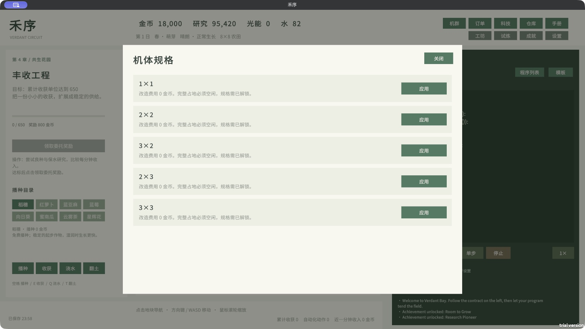

# Fleet, airframes and economy — v0.10.2

[English README](../README.md) · [中文 README](../README.zh-CN.md)

This guide describes the implemented game. Older ticket, reservation and island APIs in the roadmap are design proposals and cannot be called in v0.10.2.

## Independent progression / 独立解锁

`droneCapacity` controls the deployed-unit limit. `footprintTier` controls legal body shapes. Both are saved independently. Drone IDs are stable and are not reused after retirement; `drone_id(index)` converts a current list index to its ID. Base drone ID 0 cannot be retired.

| Research / 研究 | Earliest chapter | Prerequisite | Coins | Research points | Result |
|---|---:|---|---:|---:|---|
| Dual-Drone Scheduling / 双机调度 | 2 | motor1 | 1,200 | 180 | Capacity 2 |
| Fleet Control / 机群控制 | 4 | fleet2 | 6,000 | 900 | Capacity 4 |
| Fleet Network / 机群网络 | 6 | fleet4 | 18,000 | 3,000 | Capacity 8 |
| Square Airframe / 方形机体 | 3 | water | 2,400 | 320 | Tier 1: 2×2 |
| Rectangular Airframe / 矩形机体 | 4 | body2 | 5,400 | 800 | Tier 2: 3×2 and 2×3 |
| Heavy Airframe / 重型机体 | 6 | body32 | 12,000 | 1,600 | Tier 3: 3×3 |
| Irrigation Drone / 灌溉无人机 | 3 | water | 1,500 | 200 | Irrigator type |
| Harvesting Drone / 收获无人机 | 4 | body2 | 3,000 | 450 | Harvester type |

The starting tier is 0 (1×1). Larger tiers retain all smaller legal shapes. Research does not automatically buy, deploy or resize a drone. All prices in this table are final in-game prices, after the existing research constructor multipliers.

数量与规模互不替代。研究只解锁能力，部署与机体改造仍需付费；规格较大也需要更宽的通道。高级机群不是完成主线的强制条件，可在主线之后继续经营解锁。



## Costs and tradeoffs / 费用与取舍

- **Deployment:** base price × current deployed count. General 320, irrigator 480, harvester 640 coins. Thus a second general drone costs 320; a third costs 640. Invalid, occupied, locked or unaffordable deployment spends nothing.
- **Resizing:** `max(0, newArea - oldArea) × 180 × (footprintTier + 1)` coins. Shrinking gives no refund. At tier 1, 1×1→2×2 costs 1,080; at tier 3, 1×1→3×3 costs 5,760. Equal-area rotation costs zero but still needs clear space.
- **Maintenance:** ID 0 is free. Other drones with queued work, including blocked work, pay every 30 active game seconds: area × 1 for general, area × 2 for specialists. Idle and fleet-paused time is free. Insufficient funds pauses that drone and caps its outstanding interval at 30 seconds; there is no compounding debt. Payment resumes automatically when funds return.
- **Specialists:** irrigators only water; harvesters only harvest. Their queued work cooldown is 55% of a general drone's. They trade a narrower job role and higher upkeep for faster repeated work. Travel uses the same footprint-dependent delay.
- **Area work:** every covered plot is evaluated and billed independently. Invalid/unready plots are skipped by normal farming rules. A 3×2 watering pass can consume six units of water, not one. One anchor sensor does not summarize all covered plots.
- **Collision repair:** direct `move()` into another body costs up to 20 coins, capped at two charges per 10 game seconds across the fleet. Funds never go negative. Queued routes wait without collision fees. Boundaries do not charge repair fees.
- **Retirement:** workers must have empty queues; no purchase refund. Cancel jobs before resizing or retiring. Base ID 0 remains available for recovery with free grain.

部署：基础价乘当前已部署数量；改造：新增面积乘 180 再乘当前规格等级加一。专用机队列作业更快，但维护更贵。空闲不收费；取消、缩小或收回不返还历史投资。面板显示当前购置／改造价格，失败不扣费。

## Queue behavior / 调度规则

There is **one controller VM**, not one script per drone. A command submits work to that drone's FIFO queue (maximum 64 entries); all drones advance their queues concurrently. Coordinates are zero-based anchors at the lower-left cell of the footprint. Width runs east and height runs north.

Movement finds a shortest grid route around **current full-body occupancy**. Each actual step rechecks occupancy. Direct 1×1 movement wraps at field edges; queued paths and all larger bodies stay in bounds. Two drones cannot occupy overlapping rectangles.

This is local obstacle avoidance, not a traffic reservation solver. A crowded corridor may have no route; leave passing space or cancel and reassign a job. A blocked job whose age exceeds 30 game seconds is canceled and logged. Queue completion means the job was attempted or expired, not guaranteed crop yield; check inventory/sensors to verify production.

Run replaces the old controller and clears its queues. Pause freezes controller and queues but not crop growth; Stop clears all queues. Natural program completion leaves submitted work running. Reloaded queues are restored paused. Fleet/body/program panels do not pause simulation; other modals do.

## Implemented API / 可用接口

Actions are standalone statements and return no value. IDs, dimensions and coordinates require integers.

| Command | Meaning |
|---|---|
| `select_drone(id)` | Select the drone used by direct actions and anchor sensors |
| `deploy_drone("general", x, y)` | Deploy a 1×1 drone; also `"irrigator"` and `"harvester"` |
| `resize_drone(id, width, height)` | Apply an unlocked body shape if its full footprint fits |
| `retire_drone(id)` | Remove an idle worker, without refund |
| `queue_move(id, x, y)` | Move to an anchor |
| `queue_water(id, x, y)` | Move, then irrigate the footprint |
| `queue_harvest(id, x, y)` | Move, then harvest mature cells |
| `queue_plant(id, grain, x, y)` | Move, then plant empty eligible cells; use any unlocked crop ID |
| `cancel_queue(id)` | Clear that drone's queued work |

| Sensor | Result |
|---|---|
| `drone_count()` | Deployed count |
| `drone_capacity()` | Unlocked capacity |
| `footprint_tier()` | Unlocked size tier 0–3 |
| `drone_id(index)` | Stable ID at current list index |
| `drone_x(id)`, `drone_y(id)` | Anchor coordinates |
| `drone_width(id)`, `drone_height(id)` | Current dimensions |
| `queue_length(id)`, `drone_busy(id)` | Pending job count / whether jobs remain |
| `can_fit(id, x, y)` | Whether that drone fits there **now**, ignoring its own old footprint |

No queue for till/fertilize is provided in this release. Select a general drone and use direct `till()` / `fertilize()` to prepare its covered area. `ready()`, `crop()` and `moisture()` read the selected anchor cell; direct work applies to the whole selected body. Queue jobs resolve their destination at execution time; no reservation/ticket handle is returned.

### Two general drones, independent lanes

Deploy two general drones. Leave the left and right edge strips clear; move other workers elsewhere. Load the built-in **Two-drone lanes / 双机分区** template. It adapts row steps to each drone's height:

```python
while True:
    if drone_count() >= 2:
        for index in range(2):
            unit = drone_id(index)
            if not drone_busy(unit):
                lane = 0
                if index == 1:
                    lane = size() - drone_width(unit)
                row = drone_y(unit) + drone_height(unit)
                if row + drone_height(unit) > size():
                    row = 0
                queue_harvest(unit, lane, row)
                queue_plant(unit, grain, lane, row)
    wait(0.2)
```

This is a lane example, not a whole-field optimizer. With 3×3 bodies, use the 8×8 field to leave a central corridor. Irrigators/harvesters reject planting; use the separate **Irrigation queue / 专用灌溉队列** template for an irrigator deployed last. Observe `queue_length` rather than submitting unbounded work.

## Economic calibration / 经济校准

| Crop | Seed cost | Coins per harvested unit | Base research per harvest |
|---|---:|---:|---:|
| Grain / 稻穗 | 0 | 1 | 1 |
| Radish / 萝卜 | 2 | 3 | 1 |
| Flax / 亚麻 | 4 | 4 | 2 |
| Berry / 蓝莓 | 6 | 3 | 2 |
| Sunflower / 向日葵 | 8 | 6 | 3 |
| Pumpkin / 南瓜 | 12 | 7 | 3 |
| Tea / 茶 | 16 | 10 | 4 |
| Starbloom / 星辉花 | 24 | 18 | 6 |

Research is per harvest action, modified by existing agronomy/laboratory rules; coin income is per yielded unit. Berry regrowth and companion bonuses change return per planting. Starbloom also consumes light energy. Harvest already pays coins; orders consume inventory for an **additional 35%** of its nominal value. Processing provides research and order goods. This avoids treating inventory delivery as a second full harvest payment.

A deterministic single-base-drone replay, without adding fleet purchases, completes all 30 contracts in approximately 3,658 game seconds, with 15,463 harvested units and 38,743 remaining coins after its chosen research route. This checks solvency and progression, not a fixed duration or optimal strategy. Total optional research and full-fleet outfitting exceed that remaining balance: continuing production creates a reason to invest, while base recovery stays affordable.

## Internal acceptance sequence / 内部完整测试顺序

Use a new test campaign or back up your save first. The automation uses separate test filenames.

1. **Starting state:** new farm has one 1×1 general drone, capacity 1, tier 0. Try deploying/resizing early; both must fail without spending.
2. **Independent unlocks:** reach chapter 2, research motor1 and fleet2, deploy a second general drone. Capacity is 2 and tier stays 0. In chapter 3, research body2; tier becomes 1, capacity stays 2.
3. **Footprint:** move a drone to clear space, cancel its queue, resize to 2×2. Its visual body and marker should cover four cells. Try placing another drone inside those four cells; reject without charge.
4. **Area accounting:** plant grain with the 2×2 body. Four eligible plots are planted. After growth, harvest and compare inventory. Irrigating six dry eligible cells with a 3×2 body should bill six water, not one.
5. **Concurrency:** deploy two general drones in left/right strips, run the lane template. Both queues should move while the single controller runs. Browse another program; existing execution continues. Run another program; old queues clear.
6. **Pause and stop:** pause the controller; queue movement stops while crops grow. Resume. Stop; all queue counts become zero. Single-step must leave fleet queues paused.
7. **Roles:** unlock/deploy irrigator and harvester. Try wrong work; no crop work or resource charge. Queue their permitted job and observe faster work cooldown.
8. **Conflict:** direct-move into an occupied footprint repeatedly; no overlap, at most 40 coins charged per 10 game seconds. Queue contested destinations; machines wait, no collision charge. Block one for over 30 game seconds; cancellation appears in logs.
9. **Funding:** keep a worker queued through a maintenance interval with no money; it pauses without negative balance/debt. Use free base drone grain production to restore income; worker resumes if jobs remain.
10. **Full fleet:** unlock capacity 8, tier 3 and an 8×8 field. Mix all supported body shapes, leaving routes. Check every rectangle remains separate during movement.
11. **Persistence:** save while jobs remain, quit, reopen. IDs, dimensions, capacity and tier persist; jobs are paused until resumed. Load a v0.10.1 save and verify programs/contracts remain with a new base drone.
12. **Language:** a fresh preference defaults to English. Toggle F8 and Settings; labels, research, task guidance and fleet costs change together. Restart and check the choice persists. Player-authored code stays unchanged.
13. **Economy:** follow all 30 tasks without injected money, review order/processing rewards and optional research affordability. Record real playtime and any dominant strategy for the next tuning pass.
14. **Platforms:** run the release on Mac. For Windows, extract the complete folder on a Windows x64 machine and repeat launch, input, save/reload and language checks; native Windows acceptance remains pending.

Automated core and fleet regression: **Tools → 禾序 → 发行 → 运行规则与主线回归**. Isolated real-frame UI smoke test from a closed project:

```bash
VERDANT_UI_QA=1 "$VERDANT_UNITY_EDITOR" -batchmode \
  -projectPath "$PWD" -executeMethod VerdantPlayChecks.Run \
  -logFile "$PWD/Builds/playmode.log"
```

The UI runner enters real Play mode, exits itself, and uses `verdant-ui-verification.json`. Reports go to `InternalTestReports/release-0.10.2/`. Do not add `-quit` to this asynchronous Play test.
