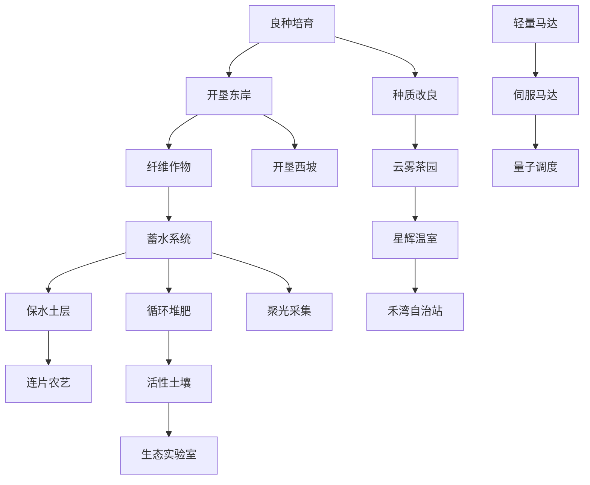

> v0.10.2 更新：多无人机与矩形机体已接入，实际接口和费用见 [FLEET.md](FLEET.md)。本文保留早期扩展设计；票据、占地预约、浮空岛接口仍为提案，不能直接在当前 VM 调用。

# 禾序 0.10：编辑器、长线生产与群岛机群

日期：2026-10-29。

## 交付状态

**已接入 Unity 游戏**：可见光标与拖选高亮、100 步内存撤销/重做、动态程序列表、切换查看不停止执行、单一执行程序、明确的任务新增收获数量与进度、树状科技界面、提高科技成本及部分前置关系、八种作物不同的新增收获数量任务。

**已做规则原型，尚未接入可玩场景**：多类型/大尺寸无人机、空间预约与队列、跨岛通行、碰撞扣费。对应的独立模拟器与验证报告随本文件交付。下文标有“拟新增”的接口不能直接复制到当前游戏运行；当前 VM 还没有对象、任务句柄和这些函数。

## 1. 编辑器和程序管理

- 光标金色、常显、宽 3 像素；选区用高对比蓝色。代码仍按纯文本编辑，避免语法颜色标签污染实际代码及选区索引。
- 撤销：Cmd/Ctrl+Z；重做：Cmd/Ctrl+Shift+Z 或 Ctrl+Y；也提供“撤销 / 重做”按钮。
- 每个程序独立保存最多 100 步编辑历史；撤销后再编辑会删除原重做分支。历史保留在本次应用会话内，代码内容仍按原方式保存到存档。
- 新农场默认一个程序。旧存档已有的四个程序全部保留，不自动删除代码。打开“程序列表”可新增、查看、删除；数量不再固定为四个，至少保留一个。
- 查看 B 时，A 的既有编译版本继续执行；修改 A 的文本也不会改变已经运行的版本，重新运行才采用修改。
- 点击“运行 B”会用 B 替换现有执行上下文，不产生第二个 VM。运行信息显示正在执行的程序编号；编辑信息显示正在查看的编号。
- 正在运行的程序不能直接删除；先停止再删。删除其他程序时会修正查看/运行编号及对应历史。
- 程序列表弹窗不暂停农场；研究、设置等其他弹窗仍按原规则暂停。退出应用后不会自动重新执行代码，需要主动运行。
- 历史以文本变更为一步，粘贴通常是一整步，逐字输入可能逐字计步；不声称跨重启保留历史。程序删除不属于代码撤销范围。

内部原因记录：原输入框在 AddComponent 时先触发 OnEnable，而文字组件随后才绑定，TMP 的 caret/selection renderer 没有创建。现在在配置完成后重新启用输入组件，已检查选区与插入光标截图。

## 2. 主线目标与数量校准（0.10.1）

已移除600秒认证及所有计时领奖条件。每种作物使用不同的数量目标，任务面板写明“本任务新增收获”与当前数量；达到数量即可立即领奖。

| 作物 | 目标单位 | 无加速/增产基准模拟 |
|---|---:|---:|
| 稻穗 | 2000 | 692秒，约11.5分钟 |
| 红萝卜 | 1000 | 694秒，约11.6分钟 |
| 蓝亚麻 | 1400 | 724秒，约12.1分钟 |
| 蓝莓 | 2400 | 694秒，约11.6分钟 |
| 向日葵 | 1300 | 715秒，约11.9分钟 |
| 蜜南瓜 | 1200 | 754秒，约12.6分钟 |
| 云雾茶 | 1250 | 700秒，约11.7分钟 |
| 星辉花 | 500 | 744秒，约12.4分钟 |

基准：6×6空田、1×、仅解锁所需作物与灌溉权限、不装马达和增产/肥力等加成、提供充足启动资金排除解锁经济影响，使用对应范例持续运行。亚麻与稻穗间作，茶与向日葵间作，星辉花与向日葵改为1:1以保持未研究聚光采集时的能源供应。正常主线回放另行验证资源与科技可达性。

接取新作物任务时记录当时的累计收获为基线；只有此后的新增收获参与该任务，历史库存和累计收获不能直接清掉下一任务。加工和订单不倒扣已完成的新增收获。新记录写入存档。旧存档正在进行的任务保留原累计量作为兼容起点，后续新接取任务采用新基线。

10分钟是数值平衡基准，不再是强制时钟。更优算法、不同田形和科技可以更快完成；这是优化收益。不能在移除计时条件的同时保证任意策略和任意科技都必须等满10分钟。

无时间门槛、任务新收获基线、差一个不能领取、达量立即领取都已加入回归。当前完整主线含科技优化的自动回放约3658游戏秒（约61分钟），不代表真人游玩时长，也不等同于无科技基准。

## 3. 当前科技树调整

金币成本为旧版的 3 倍、研究点为 2 倍；已购买科技保留。新前置关系包括：



章节限制仍然生效；树节点显示章节、价格、研究点、前置与完成状态。价格提高并不能单独保证趣味；差异化数量提供生产规模目标，而接下来的机群与群岛提供优化问题。下一轮数值调整应观察每章剩余资金，不能仅继续倍增价格。

## 4. 新模式：群岛调度局（拟新增）

核心循环：主岛生产补给 → 研究机体与渡口 → 侦察岛形 → 分配地块与工作职责 → 排队跨岛 → 在风窗内完成交付 → 用物流成绩解锁更远群岛。

采用**一个中央程序 + 多个异步任务队列**。这与“同一时间只能运行一个程序”一致：只有协调程序执行代码，无人机执行由它提交的动作任务，不各自运行第二段代码。

创意重点是把“机体体积、农业覆盖面积、地形连通性和跨岛时窗”绑在一起。扩大无人机会提高单次处理面积，也会失去窄桥和小渡口的通行能力。玩家需要选择小机穿行或大机批作，解决空间与吞吐的取舍。不能保证市场上从未出现类似机制，是否有辨识度需要封闭试玩评估。

### 机型与体型

| 机型 | 角色 | 基础尺寸 | 扩展机体 | 限制与代价 |
|---|---|---|---|---|
| 通用机 | 播种、收获、侦察 | 1×1 | 2×2 | 单项效率普通，适合首次开岛 |
| 灌溉机 | 面积灌溉 | 1×1 | 2×2、3×2、3×3 | 消耗随实际灌溉格数增长，需要水仓补给 |
| 收割机 | 连片收获 | 1×1 | 3×2、3×3 | 空间大、转弯慢，不能绕过实际播种、收获与能源成本 |
| 播种机 | 批量播种与翻土 | 2×2 | 3×2 | 扣除每个实际成功地块的种子和光能成本 |
| 运输机 | 岛间物资与电池转运 | 1×1 | 3×2 | 运载容量大，但不直接耕作；卸货占用渡口 |
| 侦察机 | 揭示地图、风窗与测绘 | 1×1 | 不扩体 | 不产资源，换取路径信息 |

2×2、3×2、3×3 表示占地矩形，不是把碰撞盒放大而仍占一个格。以左下角为锚，所有覆盖格都必须有效。3×2 旋转后变成 2×3；旋转要预留扫掠区域，不能穿过其他机体。

扩大机体必须在停机坪静止时操作；边界和邻接不再环绕。大机覆盖多个格不等于免费多倍产出，资源、作业时长、耗电与保养必须随有效作业面积增加。

### 碰撞与损失

默认教学模式使用安全预约：前方占用则排队，状态为 waiting，不扣钱。高级测试可用显式 `unsafe_move`，用于让玩家体验调度错误的维修成本。

- 对方占地、同一目标格、对向交换、交叉的扫掠区域，都视为冲突。
- 每个被接受的危险动作票据最多扣一次维修费，不能按帧反复扣款。
- 原型采用固定 20 金币，金币最低为 0；正式数值需根据当前收入分级并设单次订单罚款上限。
- 碰撞后双方停在原位，不销毁机器、不丢失整船物资，提供重规划与拖回停机坪。
- 地图外和空洞是非法路线，不等同于碰撞；返回不可达信息，不自动横跨到另一侧。
- 罚款不能把免费稻穗和主岛最低生产能力一起封死。安全等待不罚款，减少“编程错误→资金破产→无法测试程序”的循环。

## 5. 岛屿与算法梯度（拟新增）

| 岛屿 | 地形 / 规则 | 玩家需要掌握 | 典型任务 |
|---|---|---|---|
| 禾湾主岛 | 规则矩形、宽通道 | 行扫描与分区 | 单机完整覆盖，先完成八作物数量任务 |
| 裂隙岛 | 非矩形、缺口、窄通道 | flood fill、BFS / A*、边界判断 | 证明所有可耕格被覆盖，无越界指令 |
| 镜桥岛 | 单车道连接多个生产区 | 预约、令牌与会车避让 | 双向交付零碰撞，最大等待时间受控 |
| 风窗岛 | 定时开放的浮空渡口 | 时间展开图、等待边与最早到达 | 在两个连续风窗中稳定完成补给 |
| 共生环岛 | 多块相互独立的耕地区 | 图分区、巡回路径、负载分配 | 用少量灌溉机维持多岛茶园 |
| 浮光中枢 | 大小机体混行、多个渡口 | 优先级、批处理和背压 | 在能源和交通约束下完成连续物流合同 |

地图必须显式提供地块集合、通道宽度、渡口容量和机体许可。生成地图时要以“机体尺寸 + 朝向”为状态验证可达性，不能只验证 1×1 角色能通过就认为关卡合法。

跨岛不是瞬移：必须位于出发渡口、目的地已发现、科技已解锁、货物和电量合法、目的停机区域有空位；进入队列后等待风窗。航程中机器不参与两岛地面占格，目的地预约仍必须保留到降落结束。保存时记录船票、队列位置、出发和预计到达时间。

## 6. 拟新增接口契约

以下属于 **下一版 VM 接口设计**。当前 0.10 游戏里不能调用；实现时需要扩展表达式调用的返回值、多参数解析、任务票据、错误码和存档。采用扁平函数，减少初学者学习对象与方法的负担。ID 均为稳定整数，岛屿/机型使用字符串；名称与显示文案分离。

| 接口 | 返回 | 契约 |
|---|---|---|
| `deploy(kind, island, x, y, width, height)` | drone_id | 扣建造费前先检验完整占地和许可；失败返回 -1 |
| `retire(drone_id)` | bool | 仅停机坪、无未完成任务；不静默丢弃载货 |
| `drone_count()` / `drone_id(index)` | int | 枚举机群，索引越界明确报错 |
| `drone_x(id)` / `drone_y(id)` / `drone_island(id)` | 坐标/岛 ID | 航程中用状态标记，不能假装处在目的格 |
| `drone_width(id)` / `drone_height(id)` | int | 返回实际朝向对应占地 |
| `drone_state(id)` | string | idle / queued / working / waiting / travelling / fault |
| `cell_valid(island, x, y)` | bool | 检查地块存在，不以视觉颜色推断 |
| `footprint_free(island,x,y,w,h)` | bool | 检查完整矩形；仅供规划，提交时必须再次验证 |
| `enqueue_move(id, x, y)` | ticket | 提交目的地，按机体尺寸规划；不是直接穿格移动 |
| `enqueue_turn(id, orientation)` | ticket | 校验旋转扫掠占地和耗时 |
| `enqueue_water(id, x, y)` | ticket | 按可灌溉面积、土壤条件逐格计费与作业 |
| `enqueue_harvest(id, x, y)` | ticket | 成熟格逐格结算，邻接加成按确定顺序计算 |
| `enqueue_plant(id, crop, x, y)` | ticket | 实际播种逐格扣料，不预扣失败格费用 |
| `enqueue_transfer(id, portal_id)` | ticket | 加入渡口队列并申请目的停机区域 |
| `queue_length(id)` | int | 每机最多 64 个待处理任务，满时返回 queue_full |
| `ticket_state(ticket)` | string | queued / running / done / failed / cancelled |
| `ticket_error(ticket)` | string | no_path / occupied / no_energy / queue_full / no_window 等 |
| `cancel(ticket)` | bool | 取消未开始任务；已开始动作在安全点结束；释放预约 |
| `step_all(seconds)` | 无 | 推进调度器；一个中央脚本仍只有一个 VM |
| `route_exists(id, island, x, y)` | bool | 完整尺寸、朝向、通道与门户检查 |
| `next_window(portal_id)` | 游戏时间 | 查询下一出发窗口，提前规划，不鼓励盲等 |
| `unsafe_move(id, direction)` | ticket | 显式关闭安全等待，用于碰撞与维修高级测试 |

任何命令都先完整校验、再扣费或修改状态。动作票据有唯一 ID，重试同票据不会重复扣款。程序停止后：不再提交任务，已开始动作到安全点结束，未开始任务取消并释放预约；应提供专门的“暂停队列”按钮与完整说明，不能让停止程序后出现无法解释的长期自动生产。

拟议协调示例（**当前不可运行**）：

```python
water_bot = deploy("irrigator", "home", 0, 0, 2, 2)
harvest_bot = deploy("harvester", "home", 4, 0, 1, 1)
water_job = enqueue_water(water_bot, 2, 2)
harvest_job = enqueue_harvest(harvest_bot, 4, 4)
while ticket_state(water_job) != "done":
    if ticket_state(water_job) == "failed":
        print(ticket_error(water_job))
        break
    step_all(1)
```

## 7. 调度实现约束

1. 新模式使用固定模拟步长与确定性随机种子；1×/8×改变每秒推进的模拟步数，不改变命令的判定顺序。
2. 同一 tick 读取位置快照，然后收集意图、检查地形、预约目标与边、统一提交位置，不能边遍历边偷偷移动到刚空出的格。
3. 预约整块机体占地；目标冲突同票据顺序或公平轮换解决。对向交换保留原格，默认等待。
4. 狭窄通道采用单向批次或入口令牌；至少提供一个退让停机区。等待超限后取消路径并返还令牌，不能让持有者一直阻塞。
5. 路径寻路包括当前位置、朝向；有风窗时再加时间维。教学关先用 BFS，大图再使用 A*。
6. 一般多机路径规划可能死锁，不能仅凭不重叠就声称可自动解决所有路线。关卡生成需验证会车区、逃逸区、最大机体可达性；无解任务及时返回 no_path。
7. 取消、断电、存读档和跨岛失败都要释放预约；恢复时重新验证，不能沿用过期的占地锁。

## 8. 验证证据与边界

已交付 `禾序-机群与浮空岛规则验证.py`，可用 Python 3 运行，生成 `机群与浮空岛-规则验证.json`。使用确定随机种子，检查 24 项规则，包括四种尺寸绕过空洞、窄道拒绝大机、对向交换等待、同格竞争、同票据只罚一次、FIFO 渡口，以及 2000 个多尺寸随机调度 tick 的无重叠性。

它验证的是空间与队列规则原型，不代表 Unity 中已经出现机群，也不代表一般路径规划的完备性。旋转扫掠、能耗、风窗路由、跨岛存档和无人机画面仍需实施与测试。

当前游戏已验证：20 次撤销和重做、编辑分支清空重做、默认一个与 12 程序保存、删至一个的边界、切换查看保留 VM、运行新程序替换 VM、运行中程序删除保护、作物任务新增收获基线与达量即领、完整主线可达。光标、选区、科技树已做游戏画面检查。快捷键与真实鼠标拖选仍建议由本机使用者再走一遍。

## 9. 新玩法验收矩阵

| 测试 | 必须满足 | 当前状态 |
|---|---|---|
| 每种作物数量任务 | 接取后新增收获达量即可领取，不设计时 | 已接入并检查 |
| 程序切换与编辑 | 浏览不中断；始终只有一个编译执行上下文 | 已接入并检查 |
| 四种机体尺寸寻路 | 不穿空洞、不过窄道、无占地重叠 | 规则原型通过 |
| 对向交换与同格争抢 | 不越过、不过度罚款、顺序确定 | 规则原型通过 |
| 机群公平与死锁恢复 | 无永久饥饿，可取消且释放全部预约 | 待接入与压力测试 |
| 扩体 / 转身 | 扫掠区域合法且暂停坪操作 | 待实现 |
| 跨岛票据 | 有窗口、有落点、取消/读档正确 | FIFO原型通过，其余待实现 |
| 成本与经济恢复 | 无负余额、无无限修理扣费、零资金仍可恢复 | 罚款原型通过，完整经济待测 |
| 长期趣味 | 玩家通过程序优化缩短数量生产周期，非盲目等待 | 待真人试玩 |

建议先将镜桥岛做成单一封闭验证关，再加入风窗岛；在空间预约与取消规则稳定之前，不开放任意体型任意地图的组合。完成模型集成后，才能把上述拟议接口写进游戏内“手册”和模板。
