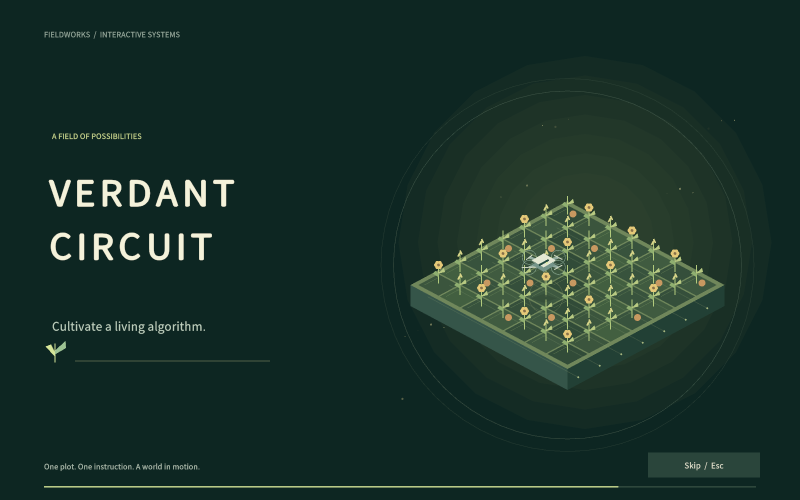
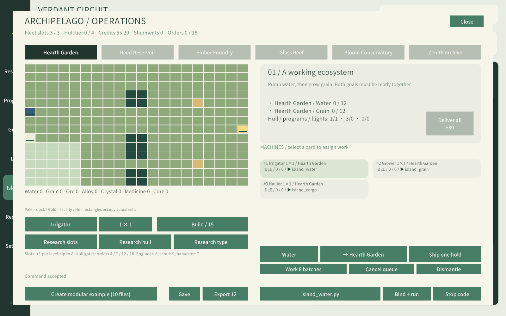

# 0.12.1 · Full campaign validation / 完整验证报告

[English operations guide](../../ARCHIPELAGO-0.12.1.md) · [完整中文代码与测试步骤](../../ARCHIPELAGO-0.12.1.zh-CN.md)

**Three fresh zero-inventory runs passed on the exact runtime below.** Each run completed the 34-node / 120-level farming route, 12 additional fleet research levels, all 18 island contracts, all six specialist roles, a fleet of eight, 3×3 hulls, seven distinct concurrent specialist programs, 13 farming achievements and 16 local race categories. No unrestricted syntax or test resource grants were used in these campaign runs. Fixture-based unit/UI tests are separate.

**三个种子均从零资源、零研究正常推进。** 原料正常生产、研究与建造正常付费，没有按秒数放行的认证。表中是1倍模拟游戏时间，保留正常科技执行加速；人工编辑、思考与点击另计，独立竞速的计时不并入主农场。

| Seed | Farming research | Island orders | Main campaign complete | Including base verifiers | Accelerated calculation |
|---|---:|---:|---:|---:|---:|
| 731 | 02:55:46 | 04:15:10 | **07:10:58** | 07:19:20 | 142.00s |
| 17 | 02:57:53 | 04:15:10 | **07:13:04** | 07:21:39 | 144.99s |
| 20261102 | 02:58:26 | 04:15:10 | **07:13:38** | 07:22:11 | 146.58s |

The reference route completes farming research first, then island logistics. Players can overlap them, use other hull mixes, or improve the dispatch algorithm; these measurements are not an enforced minimum or a speedrun record. 世界倍率提高会缩短真实等待；高效并行也可更快。时长来自不同生产链、通行限制、独立程序和多目标交付，而非固定等待门槛。

## Coverage / 覆盖范围

- 244 retained farming/language/balance/progression/naming assertions, 18 physical-fleet assertions and 434 fleet scenario assertions: **696 total**, including repeated conservation checks throughout simulated intervals.
- 23 opening checks, five real rendered captures, English/Chinese and compact aspect ratio; pointer skip, same-frame input suppression, replay, automatic finish and original pause/state restoration.
- 13 fleet UI checks with both locales and real independent worker execution. Live imported libraries appear active and cannot be deleted. UI fixtures use prepared research to exercise the interface; they are not campaign timing evidence.
- Retained real UI regression: 1133 advancing frames, 0 runtime errors; first harvest, program naming, external-file import/export, profiles, floating editors, tree navigation, completion notices, program cards and volume slider.
- Localization: 2334 locale entries checked, 0 gaps. The authored manual contains 19 chapters and 52 API groups.
- Mid-recipe and mid-flight save/reload match uninterrupted execution; cancellation/refunds and stop-all reconcile material totals. Corrupt hulls and non-finite inventories are rejected. Older farms with no island state remain loadable.
- Heavy user loops cannot freeze simulation or invalidate a later wait; self-dispatch cannot let the old task erase the new task. One worker exception leaves peers running. Messages and returned values are copied. The autonomous example's finite master ends while four island programs continue producing alloy.
- Repair-fee bankruptcy can recover by producing and exporting real goods; unavailable, reserved and negative-quantity exports are rejected. Exported goods and income enter their respective ledgers.

## Operations and algorithms / 操作与算法

1. Follow the paid manual opening: harvest five hay, buy Loops, accumulate inventory and buy language/sensor/planting tools. Expand2×2, discover trees, expand4×4, produce wood and carrots, buy dictionary/import/automatic research tools.
2. Execute the delivered farm library: checkerboard trees, budgeted carrot seeds, pumpkin repair/merge, priority sunflower harvest, two-axis cactus sorting, infected-material production, DFS maze search and Hamiltonian tail coverage. The crop-gated expansion/speed/yield economy remains intact.
3. Produce charter materials and pay100Wood+100Carrots. Buy fleet count, hull and role upgrades separately using contract credits.
4. `island_controller` calls `island_planner`. Reverse-topological recipe planning reserves goal stock and considers both incoming cargo and in-progress area-sized batches. Messages go to independent water/grain/foundry/crystal/medicine/archive/cargo programs, all importing a shared worker library.
5. Route complete occupied rectangles through each20×14island grid. Broad lanes form a directed circulation loop; small hulls have a shortcut. Atomic occupancy, docking pad anchors and landing queues prevent overlap. Cargo is reserved at acceptance, loaded physically, flown through connected islands and unloaded once.
6. Deliver all goals together. Later orders also check actual hull use, distinct program concurrency and simultaneous flights. Run base mechanism verifiers and16local races after the main campaign.

## Per-order time / 各单耗时

| # | Order / 订单 | Seed731 | Seed17 | Seed20261102 |
|---|---|---:|---:|---:|
| 01 | A working ecosystem / 运转的生态 | 00:02:02 | 00:02:02 | 00:02:02 |
| 02 | Reserve before you spend / 留足下一轮 | 00:04:22 | 00:04:22 | 00:04:22 |
| 03 | Across the first channel / 第一条航线 | 00:04:10 | 00:04:10 | 00:04:10 |
| 04 | A wider cargo hold / 更宽的货舱 | 00:05:52 | 00:05:52 | 00:05:52 |
| 05 | A two-way supply line / 双向补给线 | 00:11:03 | 00:11:03 | 00:11:03 |
| 06 | The foundry wakes / 工坊苏醒 | 00:04:35 | 00:04:35 | 00:04:35 |
| 07 | Shared lanes / 共享通道 | 00:05:56 | 00:05:56 | 00:05:56 |
| 08 | Three depots, one controller / 三仓协同 | 00:08:03 | 00:08:03 | 00:08:03 |
| 09 | Light through the reef / 礁中的光 | 00:06:36 | 00:06:36 | 00:06:36 |
| 10 | The long route / 长途航路 | 00:12:08 | 00:12:08 | 00:12:08 |
| 11 | A lattice of supply / 补给网格 | 00:17:42 | 00:17:42 | 00:17:42 |
| 12 | A living remedy / 生机配方 | 00:10:25 | 00:10:25 | 00:10:25 |
| 13 | Distributed harvest / 分布式丰收 | 00:19:01 | 00:19:01 | 00:19:01 |
| 14 | Resilience in reserve / 韧性储备 | 00:21:57 | 00:21:57 | 00:21:57 |
| 15 | The archive opens / 档案馆开启 | 00:13:29 | 00:13:29 | 00:13:29 |
| 16 | Heavy lift / 重载计划 | 00:24:30 | 00:24:30 | 00:24:30 |
| 17 | A network that endures / 持续运转的网络 | 00:35:09 | 00:35:09 | 00:35:09 |
| 18 | Verdant concord / 禾序协约 | 00:48:10 | 00:48:10 | 00:48:10 |

## Reconciliation / 对账

All seven cargo balances are zero in every seed:

`produced − recipe inputs − submitted − exported − depot stock − reserved manifests − carried cargo = 0`

Credit accounts also reconcile:

`100 charter credits + contract rewards + hull refunds + exports − hull purchases − research − emergency fees = current credits`

| Cargo | Produced | Consumed | Submitted | Exported | Depot + manifest + cargo | Difference |
|---|---:|---:|---:|---:|---:|---:|
| water | 3846 | 3398 | 386 | 0 | 62 | 0 |
| grain | 2196 | 1435 | 759 | 0 | 2 | 0 |
| ore | 1686 | 1634 | 52 | 0 | 0 | 0 |
| alloy | 1634 | 911 | 721 | 0 | 2 | 0 |
| crystal | 1174 | 633 | 530 | 0 | 11 | 0 |
| medicine | 618 | 162 | 448 | 0 | 8 | 0 |
| core | 162 | 0 | 160 | 0 | 2 | 0 |

Reference seed731 credit ledger:100 + 3660 + 660 + 0 − 1100 − 745 − 0 = **2575**. The completion route pays no emergency fees and needs no exports; recovery exports are exercised by separate scenarios.

## Reproduce / 复现

Use Unity2022.3.62f3c1. `VerdantRelease.Verify` runs model/interpreter/scenario assertions. `VerdantOpeningChecks.Run`, `VerdantFleetUiChecks.Run` and `VerdantAutomationPlayChecks.Run` require `VERDANT_AUTOMATION_QA=1` and use isolated editor profiles. Run them without `-quit`; the checks exit on completion.

For the full campaign, call `VerdantFullPlaythrough.RunPlayerGuide` without `-quit`, with `VERDANT_FULL_0121=1`, `VERDANT_PLAYTHROUGH_SEED=<seed>` and an absolute `VERDANT_PLAYTHROUGH_OUTPUT` directory. It loads the exact delivered sources and uses the game's normal interpreter/physics; it does not emulate the solution in Python.

Automation runtime source SHA-256: `26f60531486630a4a0c8a525c9cc45623b876b498d51be90a268b4a2dbd0904d`. Each seed folder contains the report, final farm with all module sources, executed phase snippets and material reconciliation. These are generated test saves, not personal player saves.

## Scope and platform limits / 范围与平台限制

Island sites share an island-local depot. Air channels are abstract flight segments; footprint conflicts are resolved on land and during landing. This version does not simulate detailed mid-air aerodynamics. Python call stacks, inboxes and result objects are transient; physical queues and cargo persist. Restart the coordinator after loading.

Build reports are included when available. Windows packages are cross-built on macOS; native Windows execution requires separate hardware and is not claimed here. Automated coverage is evidence for these routes and cases, not a guarantee for every player algorithm, hardware setup or long-running save.

## Local packages / 本地构建

- macOS universal and Windows x64 Mono: both builds succeeded with **0 errors / 0 warnings**. See `builds/macOS.json` and `builds/windows-x64.json`.
- Native macOS smoke: the packaged player rendered advancing opening frames, automatically reached the farm UI and logged no runtime exceptions. Original save folders and preferences were backed up and restored; file contents matched the backups. Captures remained local because they showed an existing player profile.
- Native keyboard injection was unavailable; keyboard/pointer behavior is covered by the real Editor UI checks, while the native smoke used automatic opening completion.
- The tested Mac player displays Unity’s `trial version` watermark and is not distribution-signed/notarized. Windows is cross-built and still needs native Windows QA. These are local test packages; GitHub0.12.1 has not been published.
