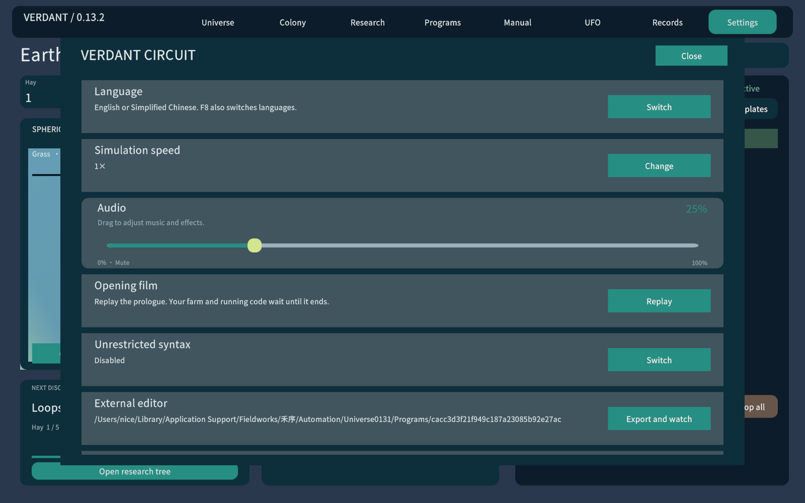

# 0.13.2 Night 本地界面补丁

仅保留Night配色，移除主题切换与浅色分支。旧存档中的theme字段被忽略，农场数据继续载入。星球强调色保留。

双语Play模式66项检查通过、0运行错误，包含旧主题JSON兼容和设置中不再出现主题切换；Mac通用版、Windows x64 Mono构建均0错误、0警告。此次只改界面，未重复从零主线计时；主线报告保留原代码指纹。Windows尚未真机测试，本补丁已纳入[0.13.2公开测试发行](https://github.com/13536309143/verdant-circuit/releases/tag/v0.13.2)。

