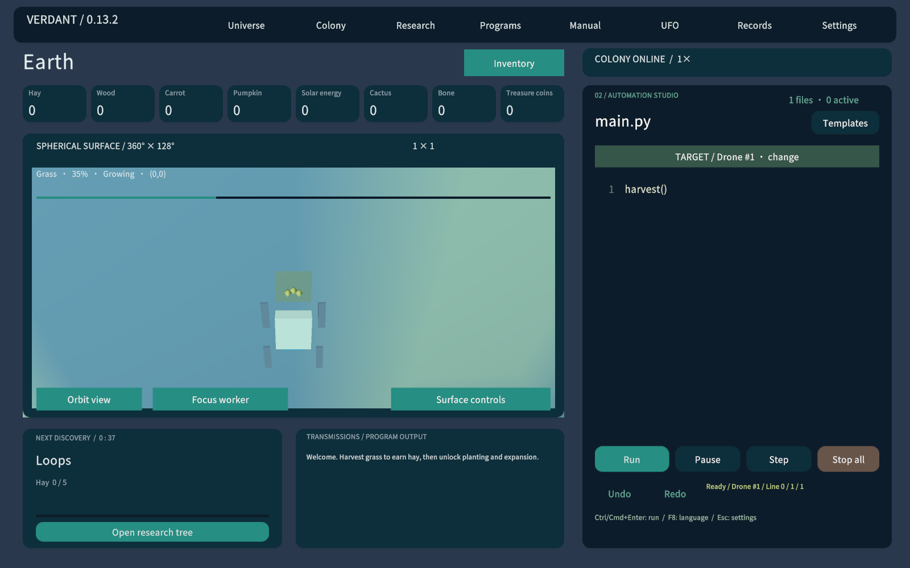
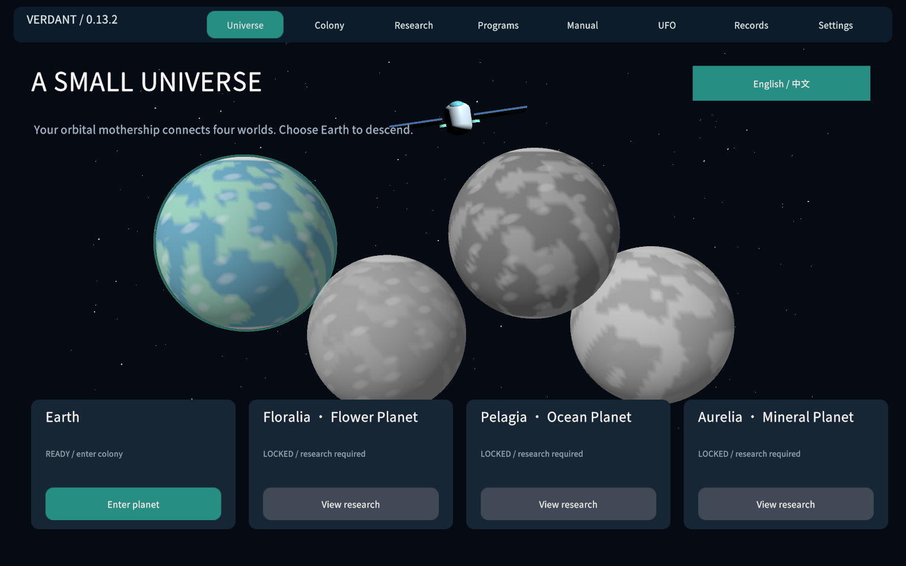
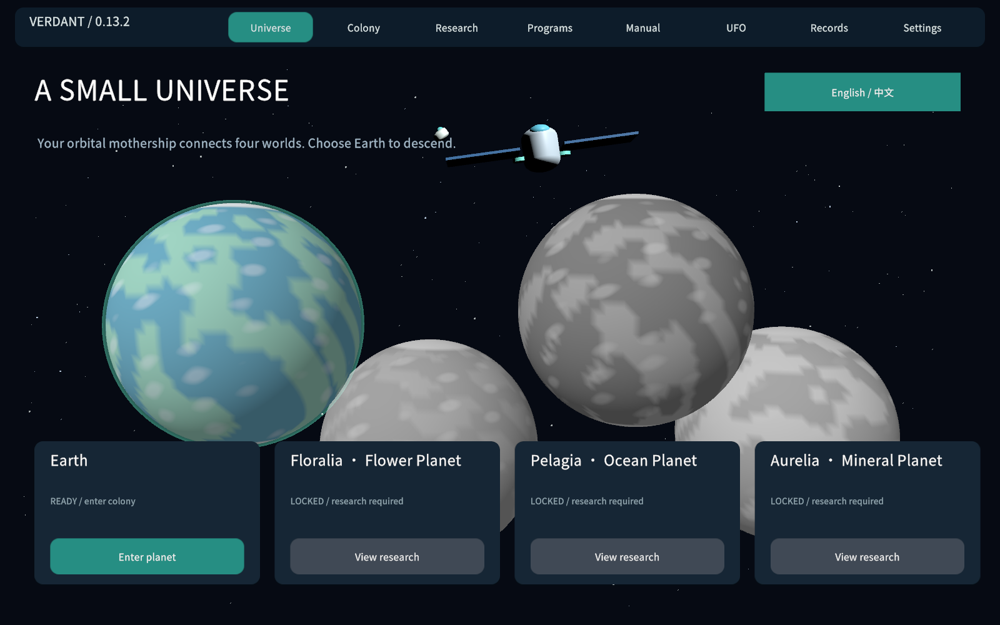
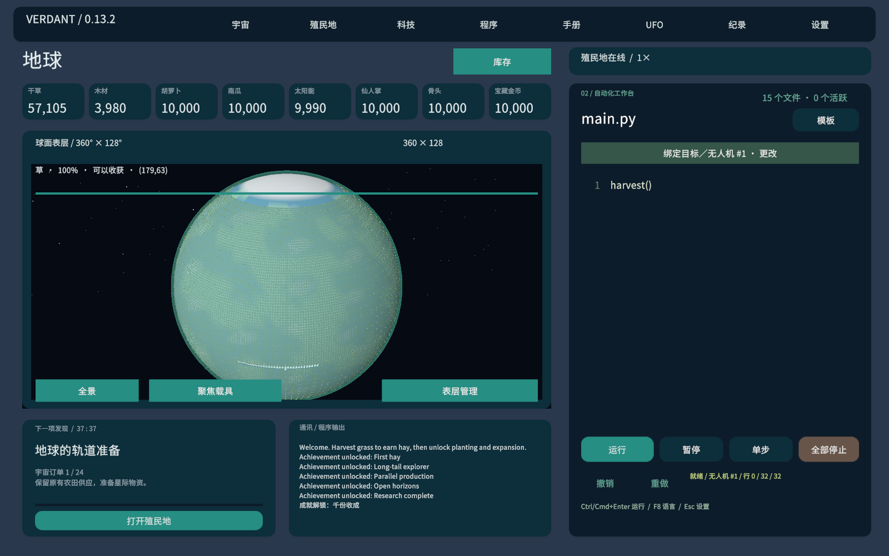

# 禾序 0.13.2 验证与完整流程计时

本报告记录0.13.2发布前的流程验证。正式公开测试包包含后续Night补丁，见[0.13.2发行页](https://github.com/13536309143/verdant-circuit/releases/tag/v0.13.2)。运行代码指纹：`dd4200c49b49ffe1e41c184ea668fef6679bf3f5074bf609b851cc0d8ea58697`。

## 验证结果

- 404项原有作物、球面、程序与函数检查，48项母舰物流、取消、仓库和专属科技检查，合计**452项断言**通过。
- 实际Play模式**64项检查、21张截图、中英文两种语言、0运行错误**。
- 一格、零库存、零科研开局，真实生产并付费完成**24个宇宙主线项目**，累计**38小时14分58秒游戏时间**。
- 自动测试墙钟耗时25.72秒，靠快速执行固定步长模拟；生产、成长、耗能、航行、研究扣费仍使用正常1倍速规则。
- UFO实际卸货**506次**，母舰实际停靠**825次**，最终资源／金钱账本通过校验。
- Mac通用版与Windows x64 Mono构建0错误、0警告。Mac独立应用开场与宇宙首页通过；Windows尚未真机运行。

## 对24小时目标的准确解释

**参考路线已超过24小时，但并不保证所有玩家都至少需要24小时。** 该路线每个星球使用一台付费2×2载具，按依赖依次补原料，先后研究三档UFO载荷和两级专属科技。实际玩家可以利用更多载具、大机体、多UFO、并行补货和更好的路径明显缩短时间；人工编程、探索与调试没有计入。

这是主线从零到第24项目的实际记录，不是按配方公式推算，不使用赠送物资／科技，不把旧版计时相加，也没有按秒数阻止交付。它不包含全成就、全部科研满级、所有星球满360×128的收集路线，也不属于最快通关纪录。

第一轮后期需求过大，参考流程达168小时以上，因此降低了新增项目交付量，保留材料链和调度差异。以上时间为调整后的最终版本。

## 实际操作与算法

1. 初始重复执行harvest()，积累五份干草研究循环，继续积累基础库存；严格检查开局一格、零库存、零科研。
2. 农场程序使用有边界的逐行扫描，回到行首再换行；棋盘树木避免相邻减速，南瓜补种枯死格，太阳花按花瓣数排序收获，仙人掌通过实际swap排序，迷宫使用DFS。通过同一付费研究方法解锁星际航行与三个星球。
3. 实际生产地球木材并出售筹资，购买UFO；送水、堆肥、鱼饵建立三座殖民地。各自生产本地物资支付8×8范围和2×2机体研究，拆除免费初始机后付费建造机体。没有直接写入制造产物。
4. 递归规划输入：本地有配方则取得每份原料并排入真实工作队列；外地产物先在来源生产，再预留货物，经母舰实际航行入库。每个批次的面积、耗时、地形定位和扣费均生效。
5. 同时交付时，后一个目标可能消耗前一个目标的库存；规划器再次核对全部目标，补齐被消耗部分后才提交，避免只满足最后一项。UFO按真实电量分批发货，返回有太阳能的泊位付费补能。
6. 原有农场生产通过真实解释器运行；后期测试驱动调用与游戏API相同的生产、研究、运输和交付方法。四个本地独立解释器保持运行以覆盖多目标程序条件。测试驱动的递归规划部分由C#实现，并非声称已交付全自动Python通关脚本。

全部阶段包含开始／结束时间、库存、算法说明及实际地球程序。见[fresh/report.json](fresh/report.json)、[24项计时与物流记录](fresh/universe-orders.json)和[地球实际程序](fresh/programs)。

| 项目 | 目标 | 本项耗时 |
|---|---|---|
| 1 | 地球的轨道准备 | 0小时00分44秒 |
| 2 | 第一座花卉殖民地 | 0小时08分03秒 |
| 3 | 矿物阶梯 | 0小时05分34秒 |
| 4 | 蔚蓝船队 | 0小时10分09秒 |
| 5 | 授粉网络 | 0小时12分51秒 |
| 6 | 贵金属回航 | 0小时12分24秒 |
| 7 | 四星联动 | 0小时23分54秒 |
| 8 | 生生不息的宇宙 | 0小时56分44秒 |
| 9 | 轨道补给站 | 0小时03分12秒 |
| 10 | 六色花园 | 0小时22分57秒 |
| 11 | 环轨铸造带 | 0小时27分53秒 |
| 12 | 远洋科考 | 0小时17分39秒 |
| 13 | 活土计划 | 0小时12分00秒 |
| 14 | 精密天文台 | 0小时45分11秒 |
| 15 | 海洋修复工程 | 0小时39分38秒 |
| 16 | 可再生基础设施 | 0小时39分31秒 |
| 17 | 晶体遥测阵列 | 1小时18分04秒 |
| 18 | 宇宙种质库 | 1小时02分01秒 |
| 19 | 银色海洋 | 1小时11分09秒 |
| 20 | 深核观测站 | 2小时37分10秒 |
| 21 | 分布式生命保障 | 0小时24分07秒 |
| 22 | 四星博览会 | 3小时44分36秒 |
| 23 | 轨道科研城 | 5小时18分33秒 |
| 24 | 自持宇宙 | 6小时30分18秒 |

## 作物与画面检查

修复了两类显示问题：原先只在成熟时改变形态、初始镜头太远，以及批量作物提交与相机重绘时序不一致。作物现在使用持续挂接到相机的批量绘制，按真实成长连续变化，小农场默认聚焦，并显示生长百分比。

实际界面检查种苗→生长、收获后清零、收获事件与特效池；失败收获不会播放虚假特效。未解锁星球在实际材质中灰度处理，独立随机轴旋转；选星球后先完成降落再进入殖民地。专属科技节点实际验证购买前暗色、购买后亮色。

## 渲染压力验证

测试平台为本机Mac Unity2022.3实际Play模式，1600×1000画面。46,080格球面带、32台地球无人机、持续生成的收获特效，以及另外三个星球的本地载具状态同时存在。模型顶点184,320，使用32位索引。收获池最多48个事件，每事件5个碎光；作物无逐格GameObject，最多8,000个可见实例，实际本次可见2217个、作物绘制3批。

采集90个不同的实际游戏帧：帧间隔中位16.70ms，P95 20.96ms；可视更新CPU中位0.888ms、P95 1.003ms。帧间隔包含Editor调度和整帧工作，CPU计数只覆盖视图更新，两者不是GPU耗时。截图导出不属于正常运行负载；结果不能保证其他机器、镜头或任意复杂场景也维持相同帧率。

## 存档及平台限制

沿用0.13.1的Universe0131存档空间，补充母舰仓库、专属科研与航段字段。旧的在途任务保留原当前航段，后续航线经母舰；已完成八单的旧宇宙可以继续第九项目。测试没有停止用户已有游戏，原版本安装包保留。

本版主要美术仍为程序生成的简化模型。Mac包未签名公证，带当前Unity许可试用水印；独立包验收范围为开场和宇宙首页，详细玩法由模型、从零流程及Editor Play检查覆盖。Windows仍需真机验收。保存实体任务、货物与程序绑定；解释器调用栈、收件箱和返回结果仍为临时状态，载入后检查队列再启动总控。
